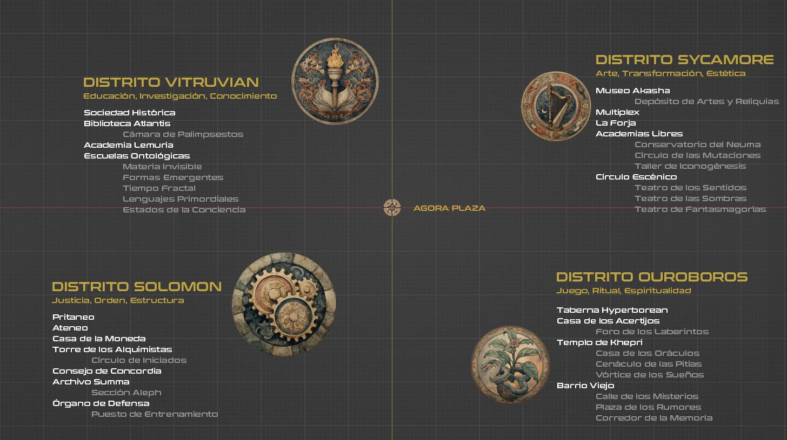
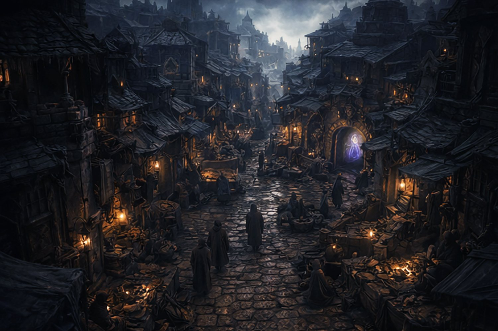
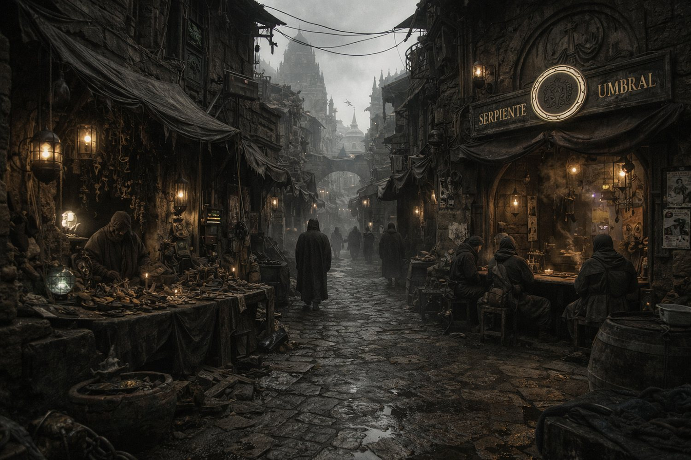
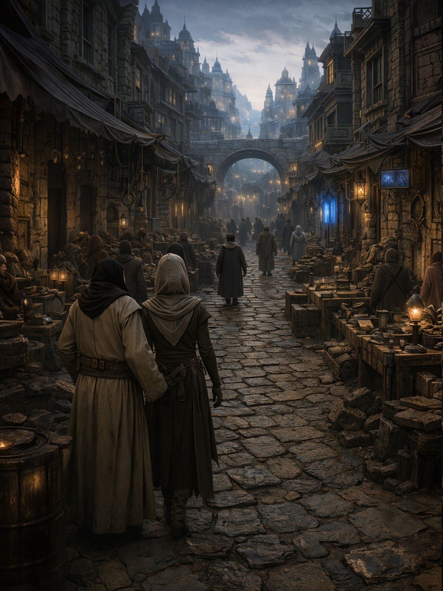
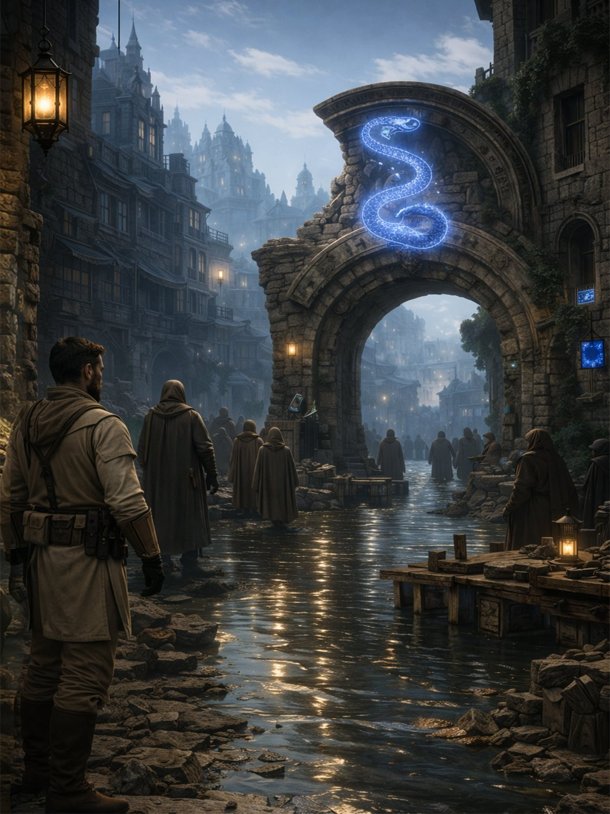
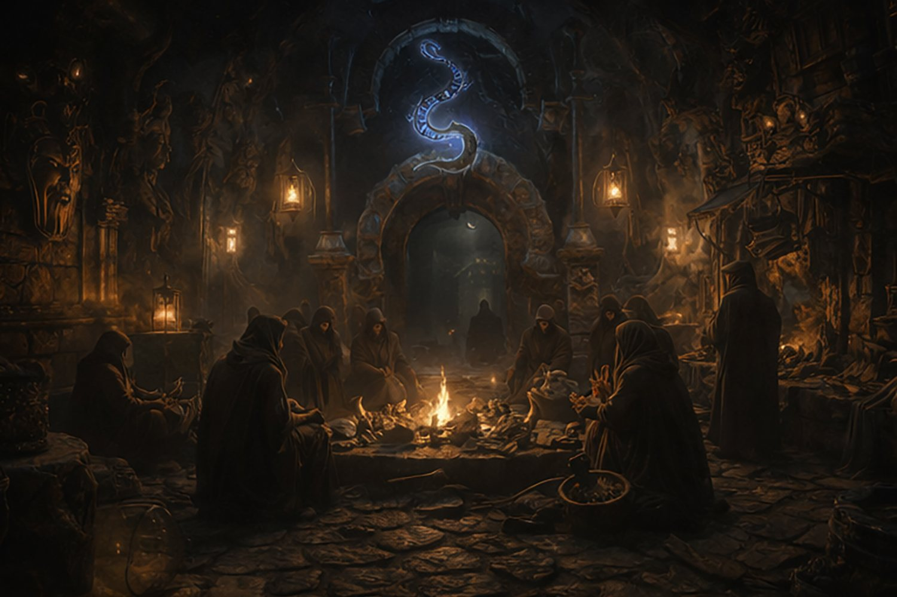
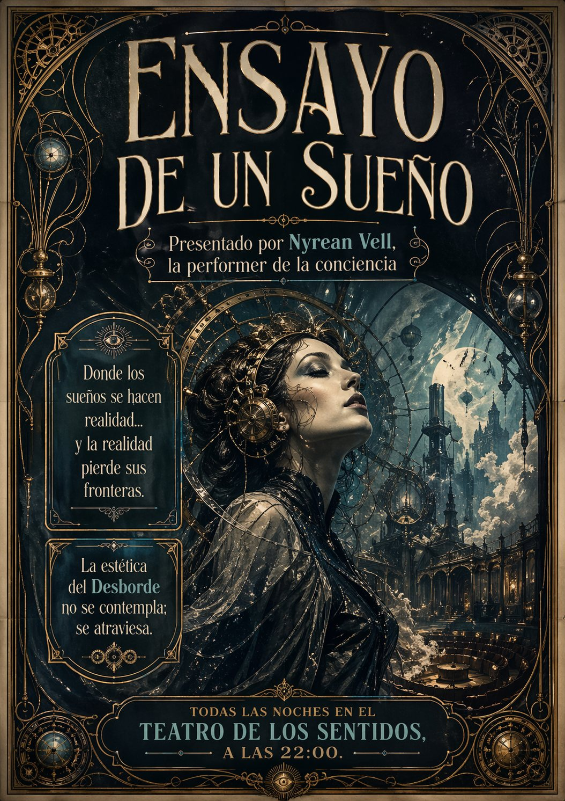

## Fase de Investigación

### Cómo dirigir la fase

*Esquema de Numinia: los cuatro distritos alrededor del Ágora. La imagen dice «Agora Plaza» (Ágora), «Taberna Hyperborean» (Taberna Hiperbórea) y «Estados de la Conciencia» (la Academia del Umbral Anímico, según el manual). Ilustración del módulo, hecha con IA. CC0.*

Es la fase más extensa de la aventura. El DJ se queda en segundo plano: guía, encauza y adapta a la Raíz lo que proponen los jugadores.

Los PJ eligen dónde investigar. El DJ no solo lo permite: fomenta que busquen información donde se les ocurra. Pueden empezar por organismos socioculturales (la Sociedad Histórica, los Archivos de Registro, la Biblioteca Atlantis), por oficinas o casas de facciones, o por los lugares ocultos y poco frecuentados de los barrios bajos de Ouroboros. Quizá acaben llegando a los tres sitios donde se puede encontrar a los antiguos miembros de la logia.

Preparar esta fase no es escribir una sucesión de escenas, porque nada garantiza que los jugadores quieran vivirlas. Es disponer posibilidades: lugares, PNJ, Piezas del Conflicto, sucesos y tensiones que entran cuando la ficción encuentra el momento. Por eso todo lo que sigue es material modular: PNJ que se pueden colocar en cualquier lugar, lugares que sirven para repartir PNJ, información y rumores, un archivo que se entrega a trozos y escenas que no dependen de ningún PJ concreto.

Libertad no es calma. En la investigación tienen que pasar cosas: un PNJ miente, alguien sigue a los PJ, aparece una criatura. Puede haber enfrentamientos y escenas de mucha tensión.

**Lo que hay en esta sección**

- Las fichas de los antiguos miembros que los PJ pueden consultar en su LAP.
- Doce PNJ modulares, en cuatro perfiles.
- Quince lugares, en cuatro entornos.
- El archivo reconstruido de la logia, como documento que se entrega por fragmentos.
- Cómo llegar a Helena Noctua, Cassian Virel e Isolde Mareth, y qué dice y qué calla cada uno.
- Cinco escenas adaptables a cualquier PJ.

**Lo que está en otras secciones**

- Los ocho rumores sobre la logia y las hipótesis que circulan: en «Propuestas potenciales» (Rumorología). Se recogen igual que el archivo, en boca de PNJ o en documentos.
- Los sueños archivados que se pueden explorar durante la investigación: en «Los sueños de la logia».
- Las Piezas del Conflicto: en «Las Piezas del Conflicto».
- Los enfrentamientos y las criaturas, con sus anclajes: en «Anclajes pregenerados para el DJ».

**Rumores.** Para averiguar qué se cuenta de la logia, el jugador explica dónde pregunta y hace una Tirada de Indagar. El DJ decide cuántos rumores tiene la fuente. Con Fracaso no obtiene ninguno; con Fallo, un rumor sin clasificar; con Éxito, un rumor con su clasificación; con Éxito total, además, de dónde viene y cómo se ha deformado. No todas las fuentes dan la misma clase de rumor: un archivo guarda versiones antiguas; una taberna, relatos deformados; un mercado clandestino, versiones interesadas. El LAP sirve para rastrear rumores en foros y canales, si el DJ considera que el asunto tiene presencia en la red.

**Piezas del Conflicto.** Para pasar a la Fase de Acción hacen falta al menos tres y algún indicio claro de hacia dónde dirigirse. Cada Pieza vale 1D6 en la Tirada de Prisma del final. No se reparten por calendario: una Pieza aparece cuando una escena ha producido algo que merece peso. Si la investigación pierde rumbo, es buen momento para recuperar una Pieza preparada.

**Cuándo termina.** Cuando las escenas empiezan a repetir información, las decisiones ya no abren caminos o la mesa pierde interés, el DJ puede provocar el tránsito. La investigación debe ser amplia, no interminable. Después, en la Fase de Reflexión, los jugadores eligen qué persiguen (ver el Espacio de Indeterminación 7).

### Fichas del LAP

En cuanto los PJ sepan de la existencia de un antiguo miembro, pueden consultar su ficha en el LAP. Es información pública. Se entrega tal cual.

| | Aurelian Thalos | Helena Noctua | Cassian Virel | Isolde Mareth |
|---|---|---|---|---|
| **Gremio / Rama / Casa** | Exégeta – Erudito – Taumaturgo | Alquimista – Menestral – Esteta | Centinela – Serafín – Guardián | Centinela – Arcángel – Exploradora |
| **Facción** | Neo-Atlantes (Distrito Sycamore) | Neo-Atlantes (Distrito Sycamore) | Círculo Estelar (Distrito Solomon) | Neo-Atlantes (Distrito Sycamore) |
| **Especie** | Mestizo (humanita-reptiliano) | Humanita | Cyanita | Espectral |
| **Posición** | Oniromante | Oniromante | Oniromante | Oniromante |
| **Situación actual** | Desaparecido | Jefa de Recursos en la Sociedad Histórica, Distrito Vitruvian | Seguridad en la Égida Liminal | Asesora de la Academia del Umbral Anímico, Distrito Vitruvian |

La ficha no lo dice todo. Isolde, aunque figure como asesora de una Academia de Vitruvian, trabaja desde su casa, en Sycamore. Helena es la única de los tres que no figura en los registros públicos como posible exmiembro de la logia. A Cassian no se puede llegar.

### PNJ modulares

Son arquetipos adaptables. Sirven tanto si los jugadores empiezan por un organismo oficial como si bucean en la Rumorología de la ciudad. El DJ los coloca en el lugar que convenga. Cada perfil indica entre paréntesis el distrito donde es más fácil encontrarlo.

Ninguno tiene la verdad. Cada uno tiene una parte, una versión o una obsesión.

#### Académicos (Vitruvian / Solomon)

**Dr. Eidon Salvaris** — Exégeta, humanita, profesor.
- Especialidad: anomalías cognitivas. Actitud: pedante, de fascinación contenida.
- Estudió la logia sin llegar a comprenderla. Tiene una teoría académica del Desborde e intenta racionalizar lo imposible.

**Lyra Voss** — Procuradora, mestiza (biomecánica-espectral), archivista.
- Especialidad: catalogación histórica. Actitud: evasiva, correctísima.
- Borró registros de la logia. Da información incompleta, con contradicciones sutiles.

**Maldon Klyne** — Oniromante del Vórtice de los Sueños.
- Especialidad: simbología. Interpretó sueños de la logia. Cree que la brújula es peligrosa.
- Hay dos versiones del personaje. En la lista de PNJ es alquimista, biomecánico, investigador teórico, un «paranoico elegante» de advertencias exageradas. En la escena del Vórtice, posterior, es espectral, casi cálido, y puede ser el antiguo maestro del PJ Oniromante. El DJ elige; la escena usa la segunda. Ver «Escenas adaptables».

#### Bohemios (Ouroboros / Sycamore)

**Ormuz «el Ciego»** — Exégeta, reptiliano, poeta.
- Escribe poemas oníricos. Alcohólico.
- Dice haber «soñado sueños robados» y haber tenido contacto directo con la logia. Sus versiones de la logia están distorsionadas.

**Nyrean Vell** — Alquimista, espectral, performer.
- Recrea sueños en escena y trabaja la Estética del Desborde.
- Tiene una cápsula colectiva con un sueño de la logia.
- Se inspira en Isolde Mareth: dice haber estudiado con ella. Sabe de arquitectura onírica.
- Tiene escena propia: ver «Escenas adaptables».

**Orfeo Drax** — Exégeta, mestizo (humanita-biomecánico), contrabandista; oficialmente, Corredor del Velo.
- Cuenta historias, todas contradictorias: rumores valiosos disfrazados de ficción.
- Traficó con sueños para la logia sin saber mucho de ella. Conoce bien la historia del Desborde.

#### Barriobajeros (Ouroboros bajo / periferia)

**K'hader «Tres Dedos»** — Alquimista, reptiliano, traficante; oficialmente, vendedor ambulante.
- Trafica con recuerdos. Habla del mercado negro de sueños.

**Mara Kint** — Procuradora, cyanita, gestora; hoy hace ingeniería fiscal ilegal.
- Fue contacto logístico de la logia. Conoce antiguas ubicaciones.
- Sabe cosas sobre Helena Noctua.

**Jex Halden** — Centinela, biomecánico, guardaespaldas.
- Trabajó para la logia como «aprietatuercas».
- Afirma haber visto a Aurelian hace poco. Información dudosa, pero provocadora.

#### Tecnológicos (Solomon / Vitruvian)

**Dorian Hoax** — Alquimista, mestizo (cyanita-espectral), hacker (analista de datos corruptos).
- Tiene registros de la logia. Sabe cosas sobre Cassian Virel.

**Marien Syn** — Alquimista, reptiliana, programadora.
- Especialista en interfaces entre el sueño y el LAP. Tiene una teoría técnica del Desborde.
- Guarda alguna muestra de sueños de la logia.

**Vektor-9** — Agente digital, entidad autónoma.
- Guarda datos sobre la logia.
- Desarrolla patrones repetitivos, casi proféticos, sobre los sueños.

### Lugares por entorno

Sitios donde pueden estar los PNJ modulares. Todos sirven para repartir PNJ, información y rumores. Los nombres y distritos siguen el manual cuando el material dice otra cosa.

#### Entorno académico (Distrito Vitruvian)

**Academia del Umbral Anímico** (Campus Escolástico). Institución prestigiosa, sobria, casi excesivamente correcta. Estudia los estados de conciencia con un rigor casi clínico y una base filosófica profunda; las clases oscilan entre lo científico y lo especulativo, y no siempre queda claro dónde acaba uno y empieza lo otro. Los profesores hablan con precisión, pero evitan ciertas preguntas.

El campus es amplio y silencioso, de jardines geométricos y caminos demasiado bien trazados. Los estudiantes hablan en voz baja, como si cualquier afirmación pudiera ser refutada por la realidad en cualquier momento. En algunas zonas el ambiente se espesa: el pensamiento se vuelve más lento o más claro según quién pase. El edificio es moderno y limpio, de superficies pulidas y materiales translúcidos. Muchos cristales, espejos y paneles reflejan de forma ligeramente imperfecta. Algunas salas no están señalizadas.

**Biblioteca Atlantis.** Monumental, casi reverencial; una de las mayores concentraciones de conocimiento de Numinia. Mezcla lo clásico con lo imposible: grandes salas, columnas, niveles que parecen extenderse más allá de lo que el edificio permite. Aquí uno se pierde con facilidad. Los textos no siempre están donde deberían, y algunos parecen esperar a ser encontrados.

Dentro está la **Cámara de Palimpsestos**, apartada del circuito habitual. Se llega tras varias secciones mal señalizadas y, en principio, de paso restringido. Los Hermeneutas trabajan en silencio, no por norma, sino por precaución. Allí se revisan los textos más antiguos y se codifican en octaedros translúcidos: estructuras de luz talladas en cristales de memoria, cuyas cadenas se proyectan a la vez como imagen, sonido, emoción, concepto y arquetipo.

**Sociedad Histórica.** Conserva, analiza y reinterpreta la historia de Numinia. No es un museo ni una academia, sino algo intermedio: aquí la historia no se da por cerrada, se discute. Oficinas ordenadas, salas de documentos, objetos y cuadros expuestos con rigor, archivos bien estructurados; todo parece sometido a una revisión continua. Algunas versiones de un mismo suceso conviven sin que nadie intente unificarlas. Aquí trabaja Helena Noctua.

**Archivo Summa.** Archivo de alto nivel donde se guardan los registros que se consideran esenciales para entender la estructura de Numinia. No es público: solo atiende con cita previa. Frío, funcional, casi un ministerio, de decoración clásica y monumental pero muy sobria. Todo está organizado con precisión extrema. Demasiada. Según el manual, su sede es itinerante y su archivo central está en las catacumbas de la Sociedad Histórica.

La **Sección Aleph** no figura en los planos oficiales y su paso está completamente restringido. Se baja por niveles inferiores hasta las catacumbas. La arquitectura cambia: menos funcional, más antigua. Guarda registros que no se pueden clasificar sin comprometer la estructura del archivo. La luz es tenue y estable, sin fuente visible. Cualquier sonido parece amortiguado, como si el lugar absorbiera la intención antes que el ruido.

#### Entorno espiritual

**Teatro de los Sentidos** (Distrito Sycamore, Círculo Escénico de la Acrópolis). Edificio de líneas sinuosas, casi orgánicas, más cultivado que construido. La fachada parece cambiar con la luz; sus relieves recuerdan cuerpos en movimiento, entrelazados en formas que la mirada no consigue fijar. Dentro, oscuridad y luces tenues y fluorescentes. No hay separación clara entre público y performers. El Teatro no representa historias: provoca estados. Sus espectáculos pueden llevar el teatro del cuerpo al límite de lo anatómico, explorar el alma como materia manipulable, usar la piel, la respiración y el pulso como lenguaje, o encarnar paradojas numínidas: acciones que contradicen su propio sentido. Aquí actúa Nyrean Vell.

**Vórtice de los Sueños** (Distrito Ouroboros, Templo de Khepri). Espacio interior del templo dedicado a la práctica de la oniromancia, entre hogueras, vapores psicotrópicos y murmullos. No es una escuela formal, sino un lugar de entrenamiento y tránsito. El acceso está medianamente restringido: no es un sitio de visita, pero tampoco está prohibido; depende de la intención de quien llega. Salas circulares, suelos grabados en espiral, luz tenue. El silencio está cargado, como si los sueños recientes no se hubieran disipado del todo. Los iniciados practican la inducción, la navegación y el retorno; no todos lo consiguen a la primera. Aquí se entrenó el PJ Oniromante con Aurelian. Tiene escena propia.

#### Entorno pintoresco (Distrito Ouroboros, Barrio Viejo)

El Barrio Viejo es el sustrato más popular de Ouroboros: calles estrechas, plazas y viejos establecimientos donde sobreviven restos de otras épocas. Se intercambian información, objetos e historias, y es uno de los focos de actividad clandestina de la ciudad. Comprende la Calle de los Misterios (mercado negro), la Plaza de los Rumores (centro de la Rumorología) y el Corredor de la Memoria (viejos cafés).

*Ouroboros, el Barrio Viejo. Ilustración del módulo, hecha con IA. CC0.*

*Ouroboros, la Calle de los Misterios. Ilustración del módulo, hecha con IA. CC0.*

**La Llave Áurea** (Calle de los Misterios). Tienda sobria, casi elegante. De paredes y vitrinas cuelgan llaves de todo tipo: antiguas, imposibles, simbólicas. Algunas no parecen abrir nada. Otras parecen haber cerrado cosas demasiado importantes.

**El Espejo de Hécate** (Calle de los Misterios). Local oscuro, lleno de superficies que reflejan: espejos pulidos, velados, rotos. Ninguno devuelve dos veces la misma imagen. La dueña nunca mira directamente a sus clientes, pero parece verlos mejor que nadie.

*Ouroboros, el Corredor de la Memoria. Ilustración del módulo, hecha con IA. CC0.*

**La Mesa del Orbis** (Corredor de la Memoria). Taberna pequeña, con una única mesa redonda en el centro. Siempre hay sitio, aunque esté llena. Las conversaciones giran, se retoman, se repiten. Quien se sienta demasiado tiempo acaba hablando de cosas que no pensaba contar.

**El Rincón de las Ménades** (Corredor de la Memoria). Más animado: música suave, risas contenidas, un ambiente cálido, casi festivo. Pero a veces la intensidad sube sin motivo claro. Aquí manda la emoción, y no siempre se queda dentro.

#### Entorno barriobajero (Distrito Ouroboros, Plaza de los Rumores)

*Ouroboros, la Plaza de los Rumores. Ilustración del módulo, hecha con IA. CC0.*

**El Candil Roto.** Local estrecho, de mesas torcidas y luz amarillenta que no acaba de alumbrar. Huele a alcohol barato y a noches largas. La clientela habla en voz baja o demasiado alta. Nadie hace preguntas innecesarias.

**La Bodega de Azogue.** Sótano húmedo, de paredes metálicas y condensación constante. El aire pesa; a ratos cuesta respirar. Se sirven bebidas turbias en vasos opacos. Algunos clientes atienden más a lo que pasa alrededor que a lo que tienen delante.

**El Jardín Sumergido.** Espacio bajo tierra, cálido y saturado de humedad, donde se fuma nimbria, una planta de hojas verdinegras que crece en el Viridial. Se inhalan sus vapores o se bebe. Aquí los recuerdos se mezclan, y no siempre vuelven a su sitio.

#### Otros lugares

- **La Taberna Hiperbórea** y **la Casa de los Acertijos**, con el Foro de los Laberintos (Ouroboros): ver «Escenas adaptables».
- **El Órgano de Defensa** (Solomon) y **la casa de Isolde Mareth** (Sycamore): ver «Los antiguos miembros».

### El archivo de la logia

El archivo reconstruido es una guía que se ofrece por fragmentos: testimonios de PNJ, documentos encontrados. El DJ decide en qué formato entrega cada fragmento (documento, declaración, rumor, sueño) y cuánto da, según cómo investiguen los jugadores. Los fragmentos llevan número romano para que el DJ sepa cuáles ha entregado.

**Quién puede tener cada fragmento.** Orientación a partir de las fichas de los PNJ; no es un reparto cerrado.

| Fragmentos | Fuentes posibles |
|---|---|
| I-V (origen, incursiones, deriva, expansión, Isolde) | Lyra Voss, que borró registros; Dorian Hoax y Vektor-9, que guardan registros y datos; la Sociedad Histórica, el Archivo Summa |
| II (Helena) | Mara Kint, que sabe cosas de Helena |
| III (Cassian) | Dorian Hoax, que sabe cosas de Cassian |
| V (Isolde) | Nyrean Vell, que dice haber estudiado con ella |
| VI-VII (el Desborde y sus consecuencias) | Eidon Salvaris (teoría académica), Marien Syn (teoría técnica), Orfeo Drax, que conoce bien la historia |
| VIII (desintegración) | Mara Kint, que conoce antiguas ubicaciones |
| IX (desaparición de Aurelian) | Jex Halden, que dice haberlo visto hace poco |
| X-XI (hipótesis y nota final) | Ormuz «el Ciego», Orfeo Drax, Vektor-9: versiones contradictorias o casi proféticas |

---

**DOCUMENTO PARA LOS JUGADORES · Archivos sobre la logia de los Navegantes del Sueño (archivo reconstruido)**

> **I. Origen de la logia**
>
> Los Navegantes del Sueño no nacieron como organización criminal, sino como corriente experimental dentro de la oniromancia aplicada.
>
> Su fundador, Aurelian Thalos, se llamaba a sí mismo Navegante de los Sueños.
>
> Su tesis inicial era simple y peligrosamente elegante: los sueños no son experiencias; son territorios. Donde otros oniromantes observaban, Aurelian quería trazar rutas. Donde otros interpretaban, Aurelian entraba. Estaba obsesionado con cartografiar los sueños.

> **II. Primeras incursiones**
>
> En sus primeras etapas, la logia operaba en tres niveles: exploradores de sueños profundos, recuperadores de información inconsciente e intérpretes simbólicos avanzados.
>
> Las incursiones consistían en entrar en sueños ajenos, registrar patrones recurrentes y clasificar estructuras simbólicas compartidas.
>
> Helena Noctua se incorporó en esta fase como analista externa. Nunca entraba en los sueños: lo consideraba invasivo y peligroso. Clasificaba símbolos, detectaba repeticiones y construía modelos interpretativos. Pensaba que, si el sueño debe ser un mapa, alguien tiene que aprender a leerlo antes de dibujarlo.

> **III. Deriva hacia lo ilegal**
>
> El punto de inflexión no fue teórico; fue económico.
>
> La logia comprendió que los sueños contienen información que el sujeto desconoce conscientemente. Y que, por tanto, encierran secretos, deseos ocultos, vulnerabilidades.
>
> Aquí entra Cassian Virel. Cassian no exploraba sueños: los consumía. Adquiría sueños robados, los vivía como propios, extraía información y la vendía o la usaba para chantajear. Sus actividades incluyeron la venta de secretos a organismos, la extorsión a figuras públicas y la manipulación política indirecta. Sostenía que una persona puede mentir despierta, pero que en sueños siempre se delata.

> **IV. La expansión**
>
> En su apogeo, la logia cambió de método. La exploración ya no era solo entrar en sueños ajenos: era robar información y, más peligroso aún, insertar ideas que influían en la conducta y las decisiones de los afectados. La clasificación simbólica siguió siendo un proceso limpio, aunque sus intenciones estuvieran contaminadas. Y el tercer nivel pasó a ser la explotación de esos activos: comercio y manipulación.
>
> Aurelian Thalos consentía este procedimiento y se beneficiaba de él. Pero en sus deseos íntimos seguía alimentando la idea de convertirse en el gran Cartógrafo del Sueño, de crear una logia de Cartógrafos capaces de trazar rutas entre sueños distintos, entre un enorme conjunto de mapas oníricos.
>
> Para eso había que aceptar que el mundo onírico era una unidad de miles de experiencias conectadas. Y que esas experiencias eran consistentes y persistentes.
>
> En ese momento, el modelo de la logia era extremadamente rentable, pero muy inestable, y profundamente ilegal.

> **V. Isolde Mareth y la arquitectura del sueño**
>
> La entrada de Isolde Mareth cambió la naturaleza de la logia. Hasta entonces, los sueños se exploraban y se clasificaban. Isolde era una creadora, una arquitecta de experiencias. Con ella, los sueños se diseñaban; se generaban de antemano.
>
> Isolde era fría como un témpano. Comulgaba con la idea de la Cartografía, y su ambición en ese terreno era desmesurada. Tanto como su falta de empatía. Eso facilitó su trabajo en la logia.
>
> Su función consistió en crear entornos oníricos artificiales, insertar sujetos en experiencias controladas y manipular el inconsciente del objetivo. Se comportaba como una torturadora sin alma, dispuesta a todo para lograr sus fines.
>
> El objetivo inicial era acceder a capas inaccesibles del inconsciente y controlar mejor la mente de los individuos. El propósito, una vez más, fue económico, aunque ya aderezado con una buena dosis de ansia de poder.
>
> El resultado real fue la alteración de la frontera entre el sueño y la vigilia.

> **VI. El Desborde**
>
> El suceso conocido como el Desborde marca el principio del fin.
>
> Empezó con un sujeto que no despertó del todo: el entorno onírico persistió tras el despertar y la realidad empezó a comportarse como un sueño. Sobre todo para él, aunque otras personas implicadas en su experiencia onírica también se vieron afectadas.
>
> Síntomas registrados: percepción alterada, objetos imposibles, solapamiento de planos, desincronización cognitiva. No fue que el sujeto no saliera del sueño. Fue que el sueño salió con él.

> **VII. Consecuencias**
>
> Tras el Desborde empezaron a producirse incidentes menores: pérdida de control sobre las incursiones, alteraciones en miembros de la logia…
>
> Algunos testimonios hablan de sueños compartidos involuntarios, de símbolos que se repiten y de la sensación de ser observado dentro del sueño.

> **VIII. Desintegración de la logia**
>
> La logia no fue disuelta oficialmente.
>
> Simplemente dejó de operar como unidad. Cada vez más investigada, sin control sobre el fenómeno, con conflictos internos, con el riesgo de ser expuesta y con el deterioro mental de Aurelian, la organización no tenía un futuro esperanzador. Cada uno se marchó por su lado e intentó limpiar su nombre lo más posible.

> **IX. La desaparición de Aurelian Thalos**
>
> Los últimos registros sobre Aurelian Thalos hablan de comportamiento errático, discurso fragmentado y una obsesión enfermiza con los «mapas incompletos».
>
> Frase atribuida: *Nos hemos perdido en el sueño equivocado.*
>
> Tras la marcha de sus compañeros, Aurelian Thalos desapareció sin que hubiera registro de su muerte ni apareciera su cuerpo. Simplemente se esfumó.

> **X. Hipótesis no verificadas**
>
> - La logia no desapareció; cambió de plano.
> - El Desborde no fue un accidente.
> - Aurelian sigue activo en algún nivel onírico.
> - Algunos sujetos nunca abandonaron del todo la red de sueños.

> **XI. Nota final (añadida posteriormente)**
>
> *Los mapas no recuerdan quién los dibujó.*
>
> (Origen desconocido)

---

**Notas para el DJ sobre el archivo**

- El fragmento XI repite, palabra por palabra, la frase que el PJ Oniromante encuentra en su cuaderno al despertar, en la Presentación. El archivo no explica por qué.
- Las hipótesis del fragmento X y las que circulan entre investigadores son Propuestas potenciales, no hechos. Están en esa sección con la frase final de Aurelian.
- Los ocho rumores sobre la logia, con su clasificación, también están allí (Rumorología). Se recogen igual que el archivo.

### Los antiguos miembros

Los PJ pueden intentar localizar a los tres antiguos miembros: Helena Noctua, Cassian Virel e Isolde Mareth. Cada uno exige un camino distinto. Helena es selectiva. Cassian es inalcanzable. Isolde se niega.

#### Helena Noctua

**Dónde.** Distrito Vitruvian. Es Jefa de Recursos en la Sociedad Histórica. Por algún motivo ha esquivado toda sospecha: es la única de los tres que no figura en los registros públicos como posible exmiembro de la logia. Oficialmente, es especialista en clasificación de estructuras narrativas anómalas.

Se la puede encontrar en las salas de archivo de octaedros de la Biblioteca Atlantis, sobre todo en los turnos de noche, o en una pequeña estancia lateral que llaman, informalmente, el Índice Ciego: una subsala donde se guardan los textos imposibles de clasificar. Su puesto es de la Sociedad Histórica, pero el trabajo la lleva a veces a dependencias de la Biblioteca Atlantis, y el Índice Ciego es una de ellas.

**Cómo llegar a ella.** Helena no es inaccesible, pero sí selectiva: como una contraseña que decide quién merece pronunciarla. La Sociedad Histórica está abierta, pero para ver a sus trabajadores hace falta un motivo. Sin cita, el acceso se complica en la recepción. La clave es negociar con la recepcionista (nombre sugerido: Alda Stravik), una biomecánica bastante rígida.

**Cómo reacciona.** Si los PJ llegan hasta ella, sea como sea, su respuesta depende de cómo abran la conversación:
- **Si nombran a los Navegantes del Sueño:** no huye, pero cierra la conversación en el acto. Solo sigue si detecta inteligencia o matiz.
- **Si describen con precisión la brújula sin aguja:** cambia por completo de actitud. Si además aportan una interpretación propia, el acceso es casi directo.
- **Si formulan una hipótesis sugerente,** aunque sea incorrecta, responde. El sistema premia la interpretación, no la verdad.

**Cómo se comporta.** No es hostil: es exigente con el significado. Habla con precisión quirúrgica, evita las afirmaciones categóricas, corrige los conceptos mal formulados y le interesa más cómo piensan los PJ que lo que saben. No responde preguntas; responde estructuras.

> PJ: «¿Qué es la brújula?»
> Helena: «No importa lo que es. Importa lo que significa.»

**Actitud progresiva.**

| Nivel de conexión | Actitud | Qué ofrece |
|---|---|---|
| Superficial | Educada, distante | Generalidades sobre oniromancia |
| Interesada | Analítica | Conceptos nuevos |
| Implicada | Inquieta | Revelaciones parciales |
| Alarmada | Urgente, tensa | Información peligrosa |

**Qué sabe y cómo lo revela.** Siempre introduce una idea nueva: «Los Navegantes no cartografiaban sueños en sí; cartografiaban coincidencias entre soñadores. Distintos sueños, distintos nodos». Lo demás lo entrega por capas, nunca de golpe:

1. **El error de concepto.** «Invadir sueños es vulgar. Lo difícil es encontrar el mismo sueño en dos mentes distintas.» Introduce la idea de sueños compartidos en su estructura.
2. **Aurelian cambió.** «Aurelian dejó de mapear sueños y empezó a buscar *intersecciones imposibles*.» Conecta con el sueño del PJ Oniromante en la Presentación.
3. **La brújula sin aguja.** «No indica dirección. Indica ausencia de dirección. Es un instrumento para moverse en sistemas donde no existe orientación. La verdadera orientación era el faro, un concepto inventado por Aurelian para conectar diversos sueños… Una leyenda.» Y: «Aurelian, al final, se llamaba a sí mismo "el Guardián del Faro"».
4. **Advertencia velada.** «Si todos habéis recibido la misma fecha y el mismo lugar, diría que no es una invitación; es una convergencia de nodos.»
5. **Fractura en el Velo.** «Hay entidades que aparecen cuando el significado colapsa.» Es una referencia indirecta a entidades primordiales, como el monstruo marino.
6. **La logia no se disolvió.** «No se separaron como decisión. Simplemente, dejaron de poder coincidir.»
7. **Los negocios sucios.** «La logia no era una organización criminal; era un sistema rentable que acabó gestionándose de manera equivocada.» Si insisten en este punto, se cierra en banda y termina la conversación.

**Qué no dirá nunca.** No explicará qué está pasando. No confirmará si Aurelian está vivo o muerto. No dará respuestas cerradas. No validará ninguna hipótesis directamente.

**Sobre Cassian.** Le reconoce inteligencia y visión, pero desprecia que instrumentalice el sueño: ha confundido acceso con derecho. «Cassian no es un monstruo, pero ha decidido comportarse como si el mundo fuera un recurso.» «Cassian no trafica con sueños; los redistribuye. Pero nunca se preguntó si debía hacerlo.» «Tiene razón en el método. Está equivocado en el límite.»

**Sobre Isolde.** Ve en ella una mente brillante, pero desatada, sin marco ético: solo impulso y resultado. «Isolde no ha cruzado una línea; ha dejado de reconocer que existía.» «Isolde siempre obtenía resultados, quizá más que ningún otro miembro. Ese es precisamente el problema.» «Hay quienes buscan comprender el umbral, y quienes lo rompen para ver qué hay detrás.»

**El fragmento de clasificación.** Helena puede entregar, dejar consultar o dejarse arrebatar un esquema incompleto: símbolos de puertas, patrones repetidos y referencias cruzadas. Es un gráfico de símbolos caóticos y reconocibles, con un orden que solo detecta un Oniromante. Está mal ordenado a propósito, bajo una clave que solo conoce Helena. Un Oniromante puede interpretarlo con una Tirada de Decodificar entorno. Es una Pieza del Conflicto potencial: su interpretación está en «Las Piezas del Conflicto» (Pieza 1).

#### Cassian Virel

**Dónde.** Trabaja en la Égida Liminal, una fortificación móvil que recorre la periferia de Numinia estudiando alteraciones y manteniéndolas bajo control.

**El Órgano de Defensa.** La única vía de contacto con la Égida es el Órgano de Defensa, en el Distrito Solomon. El acceso no es inmediato y, desde luego, no es cómodo. El edificio no parece un edificio, sino una decisión institucional convertida en arquitectura: muros lisos sin ornamento, puertas de acero cerradas, silencio administrativo, no religioso. Todo responde a una lógica clara: lo que protege no se expone. Es una de las tensiones de Numinia: una ciudad que aspira a descentralizar el conocimiento y a la transparencia, pero donde ciertas estructuras operan en la opacidad para sostener ese equilibrio.

Los PJ no hablan con la Égida. Hablan con un sistema de mediación, una interfaz protocolaria. La respuesta llega tras una espera medida:

> «La Égida Liminal no está disponible para contacto directo. Actualmente se encuentra en operación clasificada en algún lugar de la periferia.»

**Qué pueden sacar.** Si insisten con inteligencia, no con torpeza, obtienen fragmentos: la Égida es itinerante, no tiene localización fija y opera sobre anomalías del Velo, distorsiones narrativas y fallos estructurales del mundo. Es decir: no se puede llegar a Cassian Virel.

Si preguntan por su relación con la logia, reciben respuestas evasivas y negativas, sospechosas por su ambigüedad: «Esas informaciones no constan en ningún expediente oficial»; «Esas especulaciones no tienen reflejo en ningún hecho fehaciente».

Lo que se sepa de Cassian tendrá que llegar por otros caminos: Helena, Dorian Hoax, el fragmento III del archivo.

#### Isolde Mareth

**Dónde.** Es asesora independiente de la Academia del Umbral Anímico, en el Campus Escolástico de Vitruvian. Pero no acude a la sede: trabaja desde su casa, en el Distrito Sycamore. A veces tiene que presentarse en la Academia para manipular material tecnológico.

**La Academia.** El campus está abierto; pasean estudiantes, profesores y visitantes. En la entrada hay un secretario, Soren Vaelth, un espectral frío y poco afable. Imperturbable. Habla despacio y no mira a quien le habla.

> «La asesora Isolde Mareth no recibe visitas sin justificación académica formal.»

Para conseguir su dirección hace falta una Tirada de Negociar o cualquier otro recurso que se les ocurra.

**La casa.** Nodo Vectorial 3.2, número 17, barrio residencial de Sycamore. Fachada sobria, casi descuidada. Ventanas cubiertas desde dentro. Ningún símbolo a la vista. Y, aun en silencio, la sensación de una actividad interior constante.

**El encuentro.** Isolde está a la defensiva: cortante, inestable, fría, agresiva. No quiere compartir información con nadie ni dejar pasar a nadie. Niega cualquier vínculo con la logia. Tiene muy poca paciencia.

> «No sé de qué me están hablando.»
> «No trabajo con logias. No trabajo con nadie.»
> «Soy asesora independiente, y nada más.»
> «Si han venido a buscar teorías, están en el lugar equivocado.»

Cualquier alusión al Desborde o a su trabajo en la logia la pone nerviosa, agresiva, cortante, y cierra el diálogo en el acto. Pero si le tocan la fibra sensible, se traiciona:

> «Lo que ocurrió no fue un error. Fue una consecuencia.»

**Dentro de la casa.** Aquí está la verdadera recompensa. Lo que hay:

1. **Un dossier fragmentado:** diagramas de cartografía onírica, referencias a coincidencias entre soñadores y mención explícita de «puentes estables» y «anclas compartidas».
2. **Notas alteradas:** partes borradas quirúrgicamente; referencias incompletas a una «entidad observadora externa» y a una «solicitud de acceso a los repositorios». Una frase subrayada: «No fueron robados. Fueron reclamados.»
3. **Los repositorios desaparecidos:** un listado incompleto de archivos, todos marcados como transferidos, inaccesibles o reclasificados.
4. **Un registrador de sueño parcialmente quemado.** Al activarlo reproduce fragmentos inconexos y voces superpuestas; distintas voces repiten la misma frase: «Ya hemos estado aquí». Puede ser una Pieza del Conflicto: ver «Las Piezas del Conflicto» (Pieza 2).
5. **Un detalle inquietante:** en una pared, casi invisibles, marcas y nombres repetidos. Algunos coinciden con los del esquema de Helena.

Isolde sigue trabajando en los sueños. Para quién y con qué medios, nadie lo sabe.

**El sistema de seguridad.** Isolde ha instalado en su casa un clon holográfico que se carga y se activa poco después de detectar presencias extrañas. Antes se oye: «Sistema de seguridad cargado. Activando protocolo». Desde ese momento tarda treinta segundos en aparecer. Lleva una daga holográfica que hiere de verdad y se mueve y ataca a gran velocidad. Se desactiva hackeando el sistema de seguridad, instalado en el cuarto contiguo, o venciéndolo. El enfrentamiento y sus anclajes están en «Anclajes pregenerados para el DJ» (Enfrentamiento 4).

### Escenas adaptables

Estas escenas se escribieron para los PJ de una mesa concreta. Aquí están sin ellos: sin nombres de PJ, sin sus respuestas y sin lo que se construyó sobre ellas. Cuando una escena pide un PJ con un vínculo (un antiguo maestro, una escuela), el DJ la asigna a quien encaje o abre ese vínculo con una pregunta de Resonancia Dialógica: «¿Quién te enseñó aquí, y qué te dejó a deber?». Ninguna es obligatoria.

#### Escena 1. El Foro de los Laberintos

*(Casa de los Acertijos, Distrito Ouroboros)*

El Foro no es un laberinto y, sin embargo, todo en él lo es. No hay muros cerrados, sino pasillos cambiantes que desorientan. Es un espacio amplio, casi ceremonial, de salas interconectadas que cambian de forma según quién las recorra; no solo se transforman: la percepción del lugar se pliega, como en tantos rincones de Numinia. Columnas altas, superficies pulidas, espacios que parecen repetirse y, sobre todo, puertas que no siempre llevan adonde deberían. En sus paredes no hay mapas. Hay enigmas.

Es el espacio donde los Maestros de Juego estudian el diseño de acertijos y prueban sus creaciones antes de abrirlas al público.

**El Atrio de las Preguntas.** En el centro. Un espacio circular con muchos accesos, donde a los aspirantes a Maestro de Juego se los entrenaba no para responder, sino para plantear mecánicas. Silencio expectante, no vacío. Ecos que no repiten lo que dices, sino lo que piensas y no dices. Presencia constante de otros, aunque no siempre se vean.

**Elyra Senn, Custodia de Umbrales.** Humanita. Guardiana de pruebas narrativas. Cortés, impenetrable. Habla con acertijos y tiene algo de profética: no da información plana. Si un PJ se formó aquí, puede ser su antigua maestra.

Si le preguntan por Aurelian o por la logia:

> «No te diré quién trazó el mapa, pero puedo decirte qué tipo de mapa sería capaz de perder a su propio creador.»

Para sacarle algo, el PJ tiene que formular una hipótesis en forma de acertijo sobre los sueños compartidos o sobre la cartografía imposible, y hacer una Tirada de Interpretar.
- **Si acierta:** «Los Navegantes dejaron de explorar espacios… y empezaron a explorar coincidencias entre mentes».
- **Si falla:** «Los Navegantes cambiaron el timón por la madera quemada, y las velas por un puñado de pañuelos al viento».

**Kharos Galathas, Diseñador de Trampas.** Reptiliano. Antiguo Maestro de Juego, ahora retirado, o eso dice. Irónico, provocador. Sabe cosas, pero las vende envueltas en juego.

> «Aurelian, un cartógrafo que olvidó comprobar si el territorio lo estaba cartografiando a él.»
> «Te doy una verdad si sobrevives a uno de mis juegos.»

**La Cámara de las Simulaciones.** Kharos lleva al PJ a una sala aparentemente simple, con una puerta. Hay un leve temblor en el aire. Al cruzar, aparece un casino. No es un casino de Numinia: no hay máquinas holográficas, ni unidades cibernéticas, ni cartas digitales. Todo es analógico y primitivo: relojes, lámparas, máquinas tragaperras. Un maître lleva al PJ a una mesa de tapete verde rodeada de gente. Lo sientan frente a un hombre elegante, de esmoquin negro. A su lado, un hombre vestido de blanco, con un parche en el ojo, yace sobre la mesa con los sesos desparramados en un pequeño charco de sangre. El del esmoquin saca un revólver y el PJ entiende que allí no se juega a la ruleta: se juega a la ruleta rusa. El del esmoquin muestra que hay una sola bala, gira el tambor y le ofrece el arma.

**Mecánica.** El tambor tiene seis recámaras. El DJ tira 1D6 en secreto para fijar cuál tiene la bala. Después, el PJ y el DJ (por el hombre del esmoquin) tiran 1D6 por turnos. Pierde el primero al que le sale el número de la bala.
- **Si cae el del esmoquin:** todos se asombran y aplauden. El maître acompaña al PJ a la caja, donde recibe su premio, una Pieza del Conflicto (ver «Las Piezas del Conflicto»), y lo invita a salir de la simulación.
- **Si cae el PJ:** siente una onda expansiva que lo sacude todo, la simulación se deshace y se encuentra solo, sentado en una silla, en la sala de simulaciones: un espacio oscuro y circular, con luces tenues alrededor.

Gane o pierda, Kharos entra y le dice: «Tienes un talento enorme, casi único; pero no sabes protegerlo». Después le da un indicio, que el DJ elige entre el material de la investigación (un fragmento del archivo, un rumor), y desaparece.

#### Escena 2. La Taberna Hiperbórea

*(Distrito Ouroboros)*

El principal lugar de ocio y encuentro de Ouroboros. Bullicioso: culturas y tecnologías de distintas épocas de Numinia conviven con toda naturalidad. Gramófonos junto a proyectores holográficos, autómatas que sirven junto a camareros de carne y hueso; veladas de música, narraciones, espectáculos y desafíos improvisados. Tiene un amplio Salón de Juegos (tablero, cartas, estrategia, azar, experiencias inmersivas), reservados para reuniones y una zona privada, la Trastienda, a la que se entra a discreción de los dueños.

Kharos Galathas puede estar aquí en lugar de en el Foro: en el material, después de hablar con un PJ, sale con él al callejón de la taberna. Si el DJ lo coloca aquí, la Trastienda puede hacer de puerta a la Cámara de las Simulaciones.

**Las preguntas del trivia.** El Salón de Juegos puede proponer un trivia sobre Numinia. Las preguntas del material, con sus respuestas:
1. ¿Qué especie de Numinia es la menos numerosa? Los reptilianos. (pendiente: confirmarlo con el manual)
2. ¿Y la más introvertida? Los espectrales. (pendiente: confirmarlo con el manual)
3. ¿Dentro de qué organismo opera la Sección Aleph? El Archivo Summa.
4. ¿Qué distrito se encarga de la educación y la difusión de la cultura? Vitruvian.
5. ¿Cómo se llama, en general, la gran extensión de tierra que cubre la periferia? El Desierto de Antracita.
6. ¿De qué zona viene el famoso licor de bayas, tan apreciado en Ouroboros? De Kirelya.

El material no dice qué gana quien acierta ni en qué escena se usaba. (pendiente: premio y uso del trivia)

**El callejón.** Al salir, en el callejón de la taberna, puede producirse un enfrentamiento: algo empieza a filtrarse por una rejilla del suelo, y Kharos se va corriendo diciendo que «no es para él». Ver «Anclajes pregenerados para el DJ» (Enfrentamiento 6).

#### Escena 3. El Vórtice de los Sueños

*(Templo de Khepri, Distrito Ouroboros)*

*Ouroboros, el Vórtice de los Sueños. Ilustración del módulo, hecha con IA. CC0.*

El Vórtice no es una sala única, sino un conjunto de cámaras circulares conectadas, donde todo parece girar en torno a un centro invisible. Suelos grabados en espiral. Fuegos bajos que nunca se apagan. Superficies que reflejan versiones ligeramente distintas. Aquí no solo se enseña a soñar: se enseña a entrar, permanecer y regresar. El aire está cargado, como si los sueños recientes aún no se hubieran disipado. Quienes habitan el lugar no hablan mucho. Se observan. Se reconocen.

**Maldon Klyne.** Espectral. A diferencia de la mayoría de los suyos, es casi cálido: su presencia no impone, invita. Si en la mesa hay un PJ Oniromante formado en el Vórtice, puede ser su antiguo maestro. Aparece como si llevara tiempo allí, mirando el fuego.

> «Has venido tarde… o demasiado pronto. En este lugar, ambas cosas suelen coincidir.»

Maldon no habla de la logia como estructura, sino como fenómeno. Si le preguntan por Aurelian o por los Navegantes:

> «No cruzaban sueños. Eso es lo que todos creen. Lo que hacían era peor… reducían la distancia entre soñadores.»
> «Cuando dos mentes sueñan lo suficientemente parecido, dejan de estar separadas.»

Y luego, casi con pesar:

> «Aurelian no se perdió. Se quedó en un lugar donde otros no podían mantenerse.»

Si el PJ pide más, Maldon le dice que hay cosas que no se explican: tiene que entenderlas por sí mismo.

Al salir del Vórtice, en el corredor que lleva al exterior, el PJ Oniromante puede encontrarse con un hosco habitual del lugar que le tiene ganas. Ver «Anclajes pregenerados para el DJ» (Enfrentamiento 5).

**La Prueba de Permanencia.** Maldon no da más sin una pequeña prueba: «Antes de buscar a otros, dime si aún sabes regresar». Induce al PJ en un micro-sueño guiado. El entorno se disuelve y el PJ está en una versión deformada del Vórtice: los demás oniromantes no tienen rostro, el fuego arde pero no ilumina, las voces no salen de las bocas.

De pronto, por una de las oquedades, aparecen dos Depredadores del Eco. Viven en los pliegues del Akasha. Si el sueño los nombra, se invoca a los seres de esos pliegues; y si alguien los observa en el sueño, ellos también pueden ver al PJ desde allí. Entonces viajarán hasta Numinia para devorarlo: tardan en llegar unos tres días y algunas horas.

En el sueño, el PJ elige una cosa: enfrentarse a ellos (ver «Anclajes pregenerados para el DJ») o escapar (Tirada de Agilidad).
- **Si falla,** al salir del sueño ha perdido algo de su identidad. Queda Fragmentado hasta que el jugador describa qué hace su PJ para volver a reconocerse entero.
- Lo que le pase dentro del micro-sueño no le pasa en la realidad: si cae en el sueño, despierta.
- **Si sale del sueño sin daño,** Maldon confía más en él y añade: «El problema no es entrar en un sueño compartido; es que algo más esté soñando contigo». Y: «No solo las personas sueñan; el mismo Akasha está envuelto en un sueño eterno y universal, y otras criaturas tienen sueños descomunales y oscuros dentro de él».

Si los Depredadores vieron al PJ, más adelante puede llegar la emboscada: tres Depredadores del Eco asaltan a los PJ en la ciudad. Recuerda que un Depredador no cruza solo: si aparece, algo lo ha llamado, a propósito o por una corriente del Velo. Ver «Anclajes pregenerados para el DJ» (Enfrentamiento 3).

#### Escena 4. Ishara Venn

*(En el Vórtice de los Sueños)*

**Ishara Venn, Tejedora de Experiencias.** Humanita. Facilitadora de prácticas colectivas. Intensa, casi artística. No enseña técnica: enseña la experiencia emocional del sueño. Cuando llegan los PJ, trabaja con un pequeño grupo recreando fragmentos.

> «Llegas justo a tiempo. Estamos reconstruyendo algo que no debería poder repetirse.»

Ishara es la puerta hacia Nyrean Vell:

> «Hay alguien en Sycamore que ha llevado esto más lejos… Nyrean Vell, una performer que está actuando en el Teatro de los Sentidos. No estudia sueños. Los convierte en espectáculo. Lo llama… la Estética del Desborde.»
> «No recrea sueños tal como fueron; recrea lo que *dejaron atrás* cuando se rompieron.»

#### Escena 5. Nyrean Vell, la performer de la conciencia

*(Teatro de los Sentidos, Distrito Sycamore)*

*Cartel de «Ensayo de un sueño», de Nyrean Vell: «La estética del Desborde no se contempla; se atraviesa». Teatro de los Sentidos, todas las noches a las 22:00. Sirve también como documento para los jugadores. Ilustración del módulo, hecha con IA. CC0.*

**El cartel.** Por Sycamore hay carteles de su espectáculo: *Ensayo de un sueño*. Presentado por Nyrean Vell, «la performer de la conciencia». Lema: «La estética del Desborde no se contempla; se atraviesa». Teatro de los Sentidos, todas las noches a las 22:00.

**Quién es.** Alquimista, espectral. Empezó como performer en Sycamore, donde arte y realidad se entrelazan. No quería representar historias, sino experiencias internas: recrear sueños en escena, no como metáfora, sino como suceso real. No descubrió el sueño de la logia: lo persiguió. Exploró archivos fragmentados, performances olvidadas y artefactos oníricos, y entró en contacto con una anomalía del Velo. Lo que encontró no fue una corriente artística: fue una herida estética. Dice haber estudiado con Isolde Mareth.

**La Estética del Desborde.** No es un estilo. Es una experiencia en la que el símbolo se rompe, la percepción se sobrecarga y la identidad se vuelve permeable. Nyrean no la aprendió: la sobrevivió. Y la convirtió en espectáculo.

**El espectáculo.** En el Teatro de los Sentidos no hay separación clara entre público y performers, y la obra no cuenta una historia: provoca un estado. El DJ puede usar la función como puerta de entrada: los PJ no la ven desde fuera, la atraviesan.

**La cápsula de sueños.** En una de sus exploraciones, Nyrean capturó un fragmento de sueño de una logia olvidada. La cápsula no es solo un objeto: es una decisión encapsulada. Contiene un sueño incompleto. Procede de una mente colectiva, probablemente ritual. Reacciona a la interpretación y puede alterarse si alguien intenta «leerla». Es un dispositivo híbrido: mitad artefacto, mitad instalación artística, mitad error conceptual.

**Cómo es.** Una anfitriona perfecta y un incendio con guantes de terciopelo. Exuberante, teatral, provocadora. Se fascina con quien muestra sensibilidad estética. Es adicta a la admiración. Y está inquietantemente lúcida en medio del caos. Para ella, como buena neoatlante, el arte es verdad; pero coquetea con lo prohibido.

**Primer encuentro: el camerino.** Espejos que no siempre reflejan bien. Vestuario que susurra fragmentos de emociones. Una luz que cambia según el estado de ánimo de quien entra. Nyrean recibe a los PJ como si ya los conociera: flirteo intelectual, provocaciones estéticas, preguntas incómodas («¿Qué sueño te da vergüenza recordar?»). Desde el primer diálogo puede hacer que los jugadores revisen sus Hipótesis de Partida.

**Su casa: el santuario del sueño.** En Sycamore, pero ligeramente desplazada. Habitaciones temáticas, cada una un estado mental. Pasillos que cambian de longitud. Música sin fuente. En el centro, la cápsula.

**Cómo da información.** No la da: la representa.
- **Si la halagan,** se abre como una flor peligrosa: revela fragmentos del sueño e invita a los PJ a participar en experiencias.
- **Si desconfían,** se vuelve juguetona y evasiva: lo convierte todo en metáfora e introduce pruebas sensoriales.
- **Si la desafían,** se vuelve brillante y cruel: mete a los PJ en micro-performances y los obliga a enfrentarse a sí mismos.

**Para qué sirve.** Nyrean desestabiliza el Velo. Introduce Piezas del Conflicto, activa interpretaciones y no ofrece una verdad única. No quiere ayudar a los PJ. Quiere que la entiendan. Y eso tiene consecuencias.

**Giros posibles.** Son propuestas potenciales: ninguno es verdad hasta que entra en juego.
- Nyrean no controla la cápsula: el sueño la está reescribiendo.
- Ella ya forma parte del sueño: nunca salió del todo.
- La logia sigue activa y la usa como canal.
