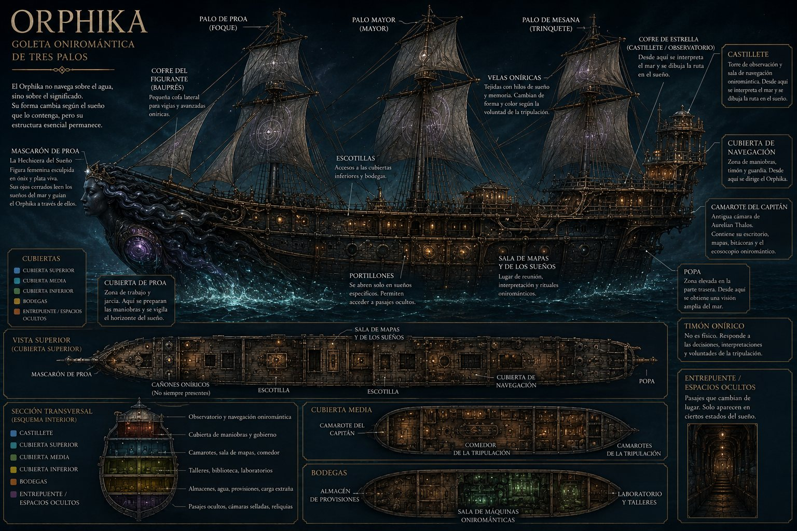
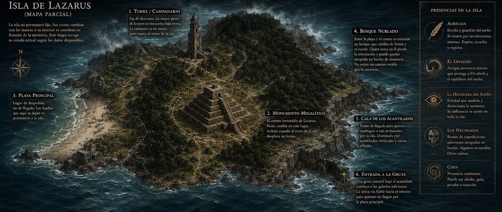

## Fase de Reflexión

Transformar posibilidades en una dirección.

La Reflexión es una pausa después de la Investigación. Los jugadores se detienen, ponen sobre la mesa las Piezas del Conflicto, recuperan sus Hipótesis de Partida y construyen una teoría común. A diferencia de la Deliberación, ya no basta con conservar varias posibilidades: tienen que elegir una.

El consenso no es dar con «la respuesta correcta». Es decidir qué interpretación van a convertir en principio de acción. De ahí sale un objetivo concreto para la Fase de Acción.

El DJ interviene poco. Puede ordenar la información, recordar Piezas olvidadas o pedir que concreten una contradicción, pero no la resuelve por ellos. Cuando hay una teoría compartida y un objetivo sobre el que se puede actuar, la Reflexión ha terminado.

### La elección

En esta aventura la elección es determinante. Antes de la Fase de Acción, los jugadores deciden qué persiguen. El DJ enfoca toda la Acción en ese objetivo y deja a un lado lo demás. La campaña no se resuelve entera, solo en uno de sus aspectos; el resto queda abierto.

Hacen falta al menos tres Piezas del Conflicto y algún indicio claro de hacia dónde dirigirse.

Algunas direcciones posibles: encontrar a Aurelian Thalos, descubrir quién hay detrás de la logia, seguir el rastro de los antiguos miembros (Helena, Cassian, Isolde) o, si la mesa los conoce, entender qué buscan los Thalos. La mesa puede proponer otra (salvar a alguien, enfrentarse a alguien, escapar de algo). La isla de Lazarus, núcleo de la Fase de Acción, se adapta a cualquiera de ellas (escenario C).

El módulo no escribe ninguna de esas ramas. Da elementos suficientes para que cada mesa construya la suya; las respuestas las crean los jugadores y las dimensiona el DJ.

### Dónde reflexionar

Conviene que el DJ cree en la ficción un espacio de reposo, en contraste con la actividad anterior: el alojamiento de los PJ, un refugio después de una persecución, una sala segura, cualquier lugar donde puedan examinar lo que han descubierto.

Si la mesa ya ha entrado en el sueño durante la Investigación, ese espacio puede estar dentro del sueño. Para ese caso, el módulo ofrece un escenario opcional: la Estación de Tránsito. En la campaña original llegó después de los tres primeros niveles del descenso y terminaba con la pregunta que fija el objetivo de la Fase de Acción.

### Escenario opcional: la Estación de Tránsito

**Qué es.** Una estación de tren suspendida en el instante anterior a algo. Todo está quieto: relojes, pasajeros, un tren con el motor encendido que no puede arrancar. Los PJ solo salen de ella cuando la tratan como un conflicto y responden a la pregunta de la Reflexión.

**El apeadero.** La llegada puede hacerse desde cualquier transporte del sueño; en la campaña original, una vagoneta de las minas.

> El traqueteo cesa con un suspiro metálico. No hay frenazo. No hay impacto. Simplemente, en algún momento, el movimiento desaparece. Y con él, el sonido.
>
> Ante vosotros se extiende un apeadero perdido en mitad de ninguna parte. Es de noche, una oscuridad sin estrellas, sin luna y sin horizonte, semejante a una hoja de papel sobre la que alguien hubiera olvidado dibujar el mundo. Un único andén de piedra agrietada. Un banco de madera envejecida. Una farola cuya bombilla amarillenta parpadea con una lentitud enfermiza. Y una caseta de estación, o lo que queda de ella, con una puerta de madera desvencijada.
>
> Sobre el banco descansa un cuaderno de tapas oscuras. Gastado. Reconocible. Es el único objeto en todo el apeadero. Como si lo hubieran colocado allí deliberadamente. Esperándoos.

El cuaderno es la segunda parte del diario de a bordo de Aurelian Thalos (ver «Documento para jugadores: el diario de a bordo», en el escenario de la Orphika). La fuente no dice qué entradas contiene. (pendiente: qué entradas forman la segunda parte; por orden, encajan las que siguen a la entrada 25)

**La estación.** Al empujar la puerta, el mundo cambia de golpe, como al atravesar una membrana.

> Al otro lado se abre una estación inmensa, construida según el optimismo elegante de mediados del siglo XX. Bóvedas de cristal curvado dejan pasar una luz blanca y cálida que no procede de ningún sol visible. Columnas de mármol crema. Bancos pulidos hasta brillar. Todo está impecablemente limpio. Todo parece perfectamente funcional. Y, sin embargo, algo resulta profundamente incorrecto.
>
> Quizá sean los relojes. Ninguno marca la misma hora. Las agujas están inmóviles. O quizá sean los pasajeros: apenas se mueven, miran al vacío. De vez en cuando, una voz femenina, cálida, tan amable que resulta inquietante, surge del techo:
>
> —Bienvenidos a la Estación de Tránsito. Próxima estación: Nivel Cuatro.

La estación está pensada para que «otro tiempo, otro aspecto» se note. Hay relojes sobre las taquillas cerradas, entre las columnas centrales, junto a las escaleras y encima de la puerta del fondo.

**Quién hay en la estación.** Cada uno repite el mismo gesto desde hace mucho tiempo.

- **El hombre del periódico.** De mediana edad, sostiene en un banco un periódico abierto del revés. No lo lee: lo observa, con el ceño fruncido, como si llevara años intentando leer la misma noticia. No pasa hoja.
- **El kiosko.** No hay kioskero. Todos los periódicos están en blanco; parecen esperar a ser reescritos.
- **La mujer de las tres maletas.** Sentada junto a tres maletas de cuero. Mira al frente. No habla. No pestañea.
- **La niña de la rayuela.** Inmóvil sobre una pierna, con los brazos abiertos, ante una rayuela de tiza cuyas casillas no tienen números. No sabe cuál es el primer salto.
- **El anciano.** Sombrero gris, abrigo largo, bastón de madera oscura. Baja de un vagón refunfuñando, mira a los PJ con desaprobación y pronuncia una sola frase, como quien lleva demasiado tiempo repitiéndola.
- **El revisor.** Un pie en el andén y otro en el estribo. Consulta sin parar un reloj de bolsillo y mira hacia la cabecera del tren. Si le preguntan, responde molesto que el tren no puede arrancar hasta que no lleguen los pasajeros adecuados.
- **La voz.** Repite el mismo aviso, como si fuera imposible apagarla.

**El tren y las salidas.** El tren espera con el motor encendido; las ventanillas reflejan versiones ligeramente distintas de la estación y el vapor escapa como la respiración de un animal dormido. Hay cuatro salidas: la puerta por la que han entrado, las escaleras a una galería superior, una gran puerta doble bajo uno de los relojes y las vías que se hunden en un túnel de ladrillo negro. Nadie usa ninguna.

**Las frases del anciano.** El DJ elige una cada vez. Solo la última es la que abre la salida.

- «¡Este tren va hacia la muerte!» · «…hacia el infierno!» · «…hacia el nivel 1!» · «…hacia el olvido!» · «…hacia el final de la línea!» · «…hacia ninguna parte!» · «…hacia donde os están esperando!» · «…hacia donde nadie regresa!» · «…hacia los sueños que olvidasteis!» · «…hacia vosotros mismos!» · «…hacia el lugar donde mueren los nombres!»
- La correcta: «¡Este tren va hacia el Abismo de Somnia!»

**Los billetes.** De pronto, cada PJ sostiene un billete que no recuerda haber recibido. En el anverso, destino, clase, vagón y asiento. En el reverso, una única frase escrita para quien lo sostiene, «o algo que se parece mucho a una verdad». El DJ escribe cada frase a partir de lo que ese PJ ha contado de su relación con la logia. En la campaña original eran reproches breves, en segunda persona, sobre algo que el PJ hizo o dejó de hacer.

**Preguntas del kiosko.** Se responden con Tiradas de Heterocósmica: lo que salga se imprime en los periódicos en blanco. Cada jugador responde a una o varias; la última es para todos.

- ¿Qué noticia podría aparecer hoy en una realidad donde Aurelian regresó?
- ¿Qué titular anunciaría el fin de los sueños?
- ¿Qué noticia anunciaría que los Navegantes del Sueño tuvieron éxito?
- Una pregunta por PJ, sobre la decisión que lo ata a la logia. Pauta: «¿Qué noticia aparecería si ___ hubiera dejado de buscar respuestas hace años?».
- ¿Qué noticia demostraría que alguien o algo está soñando con esta estación?
- ¿Qué noticia encontraría Aurelian si estuviera leyendo este periódico ahora mismo?
- ¿Qué noticia no debería existir bajo ninguna circunstancia?
- ¿Qué noticia haría que el revisor permitiera partir al tren inmediatamente?
- ¿Qué noticia provocaría que todos los relojes comenzaran a funcionar a la vez?
- ¿Qué noticia os haría decidir no subir nunca a este tren?
- ¿Qué noticia aparecería el día después del fin de los sueños?
- Para todos: ¿qué noticia os gustaría leer… pero sabéis que nunca será verdad?

**Dentro del tren.** Todos los asientos están vacíos menos uno, donde hay una «Guía del Viajero Ideal». Tiene varias versiones: si los PJ vuelven a fallar, el DJ cambia la pauta por la siguiente letra.

> **Guía del Viajero Ideal.** ¡Gracias por escoger los Ferrocarriles Oníricos de Profundidad! Antes de viajar, asegúrese de: ✓ Mantener una actitud positiva. ✓ Corregir cualquier anomalía narrativa. ✓ Escoger un destino compatible con sus expectativas existenciales.

| Pauta | a | b | c |
|---|---|---|---|
| 1. El billete | Sé honesto contigo mismo, pero también sé compasivo | Reescribe tu historia con una frase motivadora | Tu boleto espera ser redimido por tu propia palabra |
| 2. La estación | Un pasajero ideal requiere una estación ideal | Ordena la lógica de la estación | Hay elementos en la estación que requieren cambios |
| 3. Las noticias | Todos queremos un mundo con buenas noticias | El kiosko espera buenas nuevas | Inventa nuevas noticias para los periódicos del kiosko |
| 4. El destino | Un pasajero ideal sabe hacia dónde quiere ir | Decide tu destino como pasajero | Responde a la pregunta: ¿Qué es lo que busco en la siguiente fase? |

**Cómo salir de la estación.** La estación es un conflicto con anclajes. Cada PNJ es un anclaje; los relojes son otro; las noticias, otro (pasan por Tiradas de Heterocósmica, que las modifican); los billetes, otro (los jugadores inventan la frase motivadora del billete de su PJ). El último anclaje es una pregunta: ¿qué buscamos en la Fase de Acción?

Se resuelve con el sistema de enfrentamientos, que vale para cualquier obstáculo: reserva de 1D6 base más 1D6 por cada anclaje intervenido, y un objetivo declarado entre todos. Aquí el objetivo es salir de la estación.

Cuando la tirada tiene éxito, la estación se desbloquea. El anciano masculla: «¡Este tren se dirige hacia el Abismo de Somnia!». El revisor los mira: «¡Ah, ya han llegado! Podemos partir, suban al tren». La respuesta a la última pregunta es la elección de la Reflexión.

Si la mesa elige entrar en el sueño, el viaje en tren continúa en el descenso por niveles (escenario A de la Fase de Acción).

## Fase de Acción

Acelerar sin cerrar.

En la Acción el conflicto se vuelve inmediato y tangible. Los jugadores conservan la iniciativa, pero cambia la presión: ya no amplían su comprensión del Conflicto, actúan sobre él. La narración gana velocidad, riesgo y una sensación creciente de irreversibilidad, de que casi todo puede pasar.

El DJ cede autoridad creativa y aumenta su control sobre el ritmo. Las escenas empiezan cerca de su punto de tensión y terminan antes. Los desplazamientos sin decisiones se comprimen. Las aportaciones de los jugadores siguen transformando la aventura: el DJ no protege el clímax que había imaginado.

La Encrucijada es la herramienta propia de esta fase: tres interpretaciones de un elemento ya cargado de sentido, igual de comprometidas, entre las que los jugadores eligen deprisa. Lo elegido se vuelve verdad.

Antes de empezar, el DJ decide qué condiciones indican que la Acción ha terminado. La fase dura más que la Reflexión y menos que la Investigación. Termina cuando el grupo ya no intenta alcanzar el núcleo del Conflicto, sino que se enfrenta a sus consecuencias; entonces llega la Resolución.

### Caja de herramientas onírica

Lo que sigue no es una rama. Es material reutilizable para la Fase de Acción, sea cual sea el objetivo. Los escenarios A y B llevan hasta la isla; el C, la isla, es el núcleo de la Acción, y lo que los PJ encuentran en ella depende del objetivo que eligieron. Se usan todos, alguno o ninguno, en el orden que pida la mesa. Ninguno contiene la verdad de fondo; lo que signifiquen lo deciden los jugadores.

Al faro del Mar de Sílices se puede llegar despierto o en sueños (escenario B). Si la mesa no ha entrado en el sueño durante la Investigación, la Acción puede empezar directamente en el faro.

En la campaña original se encadenaron así: descenso por niveles, el faro y la Orphika, y la isla.

**Entrar en el sueño.** El módulo no fija cómo. Pregunta para la mesa: ¿cómo entráis en el sueño colectivo y qué precio tiene hacerlo? La Pieza del Conflicto sobre los niveles del sueño sirve de base para la respuesta.

**Los niveles.** Los textos numeran las profundidades del sueño (nivel 1 el barco, «Nivel Cuatro» la estación y el Abismo, el faro como puerta del nivel cinco). El número de niveles y lo que hay en cada uno se dimensionan con esa Pieza. (pendiente: escala definitiva de niveles)

**La forma en el sueño.** Dentro del sueño, cada PJ puede tener otra forma. Pregunta para cada jugador: ¿qué forma adopta tu PJ en el sueño?

### Escenario A: el descenso por niveles

Una sucesión de profundidades, no un paisaje. Cada nivel se abre dentro del anterior.

**Nivel 1. El barco abandonado.** Silencioso como un mausoleo flotante. Todo indica que es la nave con la que Aurelian emprendió su último viaje. Puede ser la misma *Eidolon* del sueño colectivo de la Fase de Investigación.

**Nivel 2. La bodega.** La bodega del barco, con innumerables barricas de un licor extraño. El sueño repite un símbolo que ya apareció al principio de la investigación, como si insistiera en algo cuyo significado aún no se entiende. El DJ usa un símbolo que la mesa haya plantado antes (en la campaña original, un detalle del Café de los Escribas).

**Nivel 3. Las minas.** El tercer nivel se oculta dentro de una de las barricas. Unas escaleras imposibles bajan a unas minas atravesadas por raíles interminables, por los que corren solas las vagonetas.

- **El diario.** Allí está la primera parte del diario de a bordo de Aurelian (ver el documento para jugadores en el escenario B).
- **Los retratos.** Retratos fotográficos vivientes conversan entre sí; los PJ pueden sorprender la conversación. Pregunta para la mesa: ¿qué secreto se cuentan los retratos, y sobre quién?
- **La salida.** Una vagoneta lleva más abajo. En la campaña original, a la Estación de Tránsito; si la Reflexión ya se hizo fuera del sueño, puede llevar directamente al tren.

**Nivel 4. El tren y el Abismo de Somnia.** El tren entra en el túnel.

> La oscuridad ocupa las ventanas. Durante varios minutos solo existe el rumor de los raíles, regular, hipnótico, como el latido de algo gigantesco. Poco a poco aparecen cosas al otro lado de los cristales. Primero reflejos. Luego sombras. Después paisajes soñados.

Pregunta para la mesa: ¿qué aparece al otro lado de las ventanas?

> El ruido de los raíles se convierte en el murmullo de miles de voces: recuerdos, promesas, plegarias, nombres. Después, una oscuridad más pesada. El tren ya no parece avanzar sobre raíles; parece navegar. Muy lejos aparece una luz, una única estrella que crece hasta ocupar el horizonte entero. No es una ciudad. No es un sueño. Es una profundidad.
>
> —Próxima estación —susurra la voz. Una pausa—. El Abismo de Somnia.

El tren se detiene y desaparece.

> Parece una grieta, pero una grieta tiene bordes, y esto no. Se extiende hacia arriba, hacia abajo y hacia delante, como si alguien hubiera rasgado la realidad. Para bajar hay un montacargas que parece una jaula. Desciende lentamente entre paredes de roca negra muy lejanas, estratos que parecen los sedimentos de millones de sueños. Y excavadas en ellas, miles de estancias, como recuerdos convertidos en arquitectura.

Las estancias pasan ante la jaula y desaparecen. El DJ elige las que necesite:

- Una biblioteca gigantesca, vacía, cuyas páginas se pasan solas, como si alguien invisible buscara una frase.
- Un observatorio cuyos telescopios apuntan hacia el interior de la montaña.
- Un gabinete con instrumentos quirúrgicos, mapas oníricos y diagramas imposibles; las lámparas siguen encendidas, como si quien trabajaba allí acabara de marcharse.
- Un salón de reuniones: doce sillas, once ocupadas, la duodécima vacía. Nadie tiene rostro.
- Una habitación infantil con un caballito de madera, un libro abierto y una ventana que muestra un paisaje distinto cada segundo.
- Laboratorios, archivos, criptas, aulas, jardines, capillas, teatros, celdas, talleres, ciudades enteras excavadas en la roca.

Esas estancias pertenecen a quienes llegaron hasta el Abismo y dejaron algo atrás: oniromantes, exploradores, visionarios, locos. Un refugio, una teoría, un fracaso, una pregunta.

> Las paredes se alejan. La roca desaparece. Aquello que habíais tomado por el Abismo solo era su borde. Entonces lo veis: una ciudad tan vasta que los continentes parecerían barrios, construida con memorias, con sueños, con cosas que todavía no han ocurrido. Un instante después parece una red luminosa que conecta todas las mentes. Y tampoco es eso: cada definición se rompe en cuanto intentáis sostenerla.
>
> Aquí está todo. Todos los sueños, todos los recuerdos, todas las versiones posibles de cada vida. Y vosotros también estáis aquí. Siempre habéis estado. El Abismo no roba la memoria ni la identidad. Roba la capacidad de quedar satisfecho. Por eso tantos oniromantes lo buscan: promete todas las respuestas. Y por eso tantos lo temen: las cumple.
>
> Después de mirar dentro del Abismo de Somnia, regresar se convierte en una pregunta mucho más difícil que descender.

**La vuelta a la bodega.** La jaula se detiene en la oscuridad. En el suelo húmedo hay un cuaderno de bitácora grande, viejo, enmohecido. Luego vuelve el olor de la bodega: la misma del nivel 2, ahora más oscura, más densa, como si el espacio se tragara el sonido. (pendiente: de qué nave es el cuaderno; la fuente le da otro nombre)

**Enfrentamiento: el Guardián de Crisálida.** En la bodega espera la misma criatura que en la bodega del sueño de la *Eidolon*: el Guardián de Crisálida, encadenado a una gema sobre un pedestal y visible solo durante sus destellos. Su ficha es el enfrentamiento 2 de «Anclajes pregenerados». En esta vuelta, la bodega está más oscura, más densa, como si el espacio se tragara el sonido.

**El disco de sincronización.** Al fondo de la bodega, sobre una barrica, brilla un objeto circular y metálico. Al girarlo ofrece una combinación cifrada: las coordenadas del faro que se alza en medio del Mar de Sílices, la tierra árida y rocosa del Desierto de Antracita. Es la Pieza de Dirección del módulo. El faro es un lugar físico, pero también se llega a él en sueños: ver escenario B.

**Nivel 5. El faro.** El descenso desemboca en el faro del Mar de Sílices, visto desde el sueño. Sigue en el escenario B.

### Escenario B: el faro del Mar de Sílices y la travesía de la Orphika

**Dos maneras de llegar.** El disco de sincronización, la Pieza de Dirección, da las coordenadas del faro. Los PJ pueden llegar de dos maneras:

- **Despiertos, de forma física.** Con las coordenadas, el viaje sale de Numinia hacia la periferia, hasta el Desierto de Antracita. El Mar de Sílices no es un mar: es una extensión de tierra oscura, árida y rocosa donde no crece nada. Pregunta para la mesa: ¿cómo llegáis hasta allí y qué os cuesta el viaje?
- **En sueños.** Al final del descenso (escenario A), el nivel cinco se abre sobre el mismo paisaje.

Lleguen como lleguen, el faro es el lugar donde la vigilia y el sueño se tocan: al subir a lo alto, los PJ conectan con el mundo del sueño.

**El faro.** Es el faro que el Oniromante vio en su escena de la Fase de Presentación: solitario, inclinado unos grados, con una luz que titilaba y de pronto se apagó. El DJ puede repetir alguna imagen de aquella escena.

> Al principio creéis que es un espejismo. En mitad de la llanura negra, donde la sílice cruje bajo los pies como cristal molido, se alza una torre. Está sola. Inclinada, como si llevara siglos resistiendo un viento que hoy no sopla. No hay camino que lleve hasta ella. Y, sin embargo, las pocas huellas que hay en el suelo van todas en la misma dirección.
>
> De cerca, la piedra del faro no es la del desierto. Es más clara, porosa, salada, como si la hubieran sacado del fondo de un mar. La puerta está abierta. Dentro, una escalera de caracol sube hacia la oscuridad.

**La subida.** El DJ elige uno o dos de estos elementos interpretables:

- Unas marcas a lápiz en la pared, con alturas y fechas, como las que se hacen a un niño que crece. La última está muy por encima de cualquier cabeza.
- Una brújula sin aguja grabada en un peldaño, con los cuatro párpados cerrados.
- Una placa de latón junto a una puerta: «Guardián del Faro». El nombre que seguía está raspado. Helena Noctua recuerda que, al final, Aurelian se llamaba a sí mismo así.
- El rumor de un mar que no existe. A cada vuelta de la escalera se oye más cerca.

Pregunta para la mesa: ¿qué encontráis a mitad de la subida que os hace dudar de seguir?

**Arriba.** La escalera termina en la sala de la linterna.

> La gran lente está apagada, cubierta de un polvo negro que brilla. Por los cristales se ve la llanura entera, inmóvil hasta el horizonte.
>
> Y entonces cambia. No de golpe: como cambia un sueño, sin que nadie pueda decir cuándo empezó. La sílice se oscurece. Se ondula. Lo que era roca empieza a respirar. Abajo, alrededor del faro, ya no hay tierra. Hay un mar de aguas negras, lentas, pesadas como el aceite, que golpean la base de la torre con un sonido que conocéis aunque nunca lo hayáis oído.
>
> Y junto al faro, donde hace un momento no había nada, flota un barco. Grande. Tres palos. Las velas recogidas. En la proa, una mujer esculpida con los ojos cerrados mira hacia la torre, como si esperara.

Es la Orphika. Desde ese momento los PJ están en el sueño, hayan llegado como hayan llegado. Al pie del faro, donde antes había roca, ahora hay un embarcadero de madera.

- Pregunta para cada jugador: ¿qué reconoce tu PJ en el sonido de esas aguas?
- Si llegaron despiertos, pregunta para la mesa: ¿qué pasa con vuestros cuerpos mientras estáis en el sueño? ¿Siguen en el faro?

**La nave no se mueve.** Los PJ pueden subir a bordo, recorrerla y tocar el timón. La Orphika no se mueve. Las velas no responden. No hay viento ni corriente, y el mar negro no lleva a ninguna parte porque no tiene dirección.

**La guía de zarpe.** En el puesto de mando, junto al timón onírico, hay una guía. Es un documento para los jugadores:

> **Orphika. Procedimiento de zarpe**
>
> Goleta oniromántica de tres palos. Amarre: faro del Mar de Sílices.
>
> 1. La Orphika no navega hacia lugares. Navega hacia una luz.
> 2. Antes de soltar amarras, enciéndase el faro. La luz traza el rumbo; la nave lo sigue.
> 3. Sin luz no hay rumbo. Sin rumbo, este mar no deja salir.
> 4. La lámpara no se alimenta de aceite ni de corriente. Se alimenta de […] *(una mancha de agua ha borrado el resto de la línea)*
> 5. Una vez trazado el rumbo, no se apague el faro hasta haber perdido de vista la torre.
>
> *Al margen, a mano:* «Esta vez, que la encienda otro.»

Los PJ pueden no saber que hay que encender el faro. Solo lo descubren si encuentran la guía. Pregunta para la mesa: ¿de quién es la nota del margen y qué quiere decir «esta vez»?

**Encender el faro.** El módulo no fija con qué se enciende: la línea borrada es un Espacio de Indeterminación de esta escena. Pregunta para la mesa: ¿con qué se enciende la luz del faro? Lo elegido se vuelve verdad, y tiene un precio. Algunas posibilidades:

- Un recuerdo que alguien del grupo entrega a la lámpara y pierde para siempre.
- El disco de sincronización, encajado en el mecanismo de la lente.
- La canción «Sin aguja», cantada en lo alto de la torre (Anexo B).
- Otra cosa que proponga la mesa.

Encender el faro es un enfrentamiento (ver «Enfrentamientos de la isla»). El objetivo es encender la luz y trazar el rumbo. Anclajes posibles:

- **La lente cubierta de sílice.** Por mucho que la limpien, el polvo negro vuelve. Intervenciones: cubrirla, mojarla con el agua negra, girarla hacia el lado limpio.
- **La oscuridad que bebe la luz.** La primera chispa se apaga enseguida, como si algo la absorbiera. Intervenciones: proteger la llama, alimentarla con lo que la mesa haya elegido, encenderla entre todos a la vez.
- **El mecanismo detenido.** Los engranajes que hacen girar la lámpara están quietos, inclinados como la torre. Intervenciones: enderezarlos, forzarlos, buscar la pieza que falta.

**Fallo.** La luz no prende. Hay que probar con otro anclaje.

**Fracaso.** Deja un estado en quien intervino (por defecto, Desanclado) y cambia la escena. La luz se enciende, pero traza un rumbo torcido: la Orphika llegará igualmente, pero pasando primero por el bosque invertido y con la Tormenta ya encima.

**Éxito.**

> El haz cae sobre el agua negra y no la ilumina: la dibuja. Sobre el mar aparece un camino de luz que se pierde en el horizonte. Las velas se hinchan sin que sople el viento. Los cabos se tensan solos. La Orphika se pone en marcha.

**La nave.** La Orphika es una goleta oniromántica de tres palos. No navega sobre el agua, sino sobre el significado: su forma cambia según el sueño que la contenga, pero su estructura esencial permanece.

Es la nave gemela de la *Eidolon*, la de Aurelian. Su última referencia la sitúa en un Hangar Sumergido de Antracita. Aun así, su camarote del capitán también fue de Aurelian: las dos naves tuvieron su cámara.

**El plano**, para enseñar a los jugadores:

*Plano de la Orphika, goleta oniromántica de tres palos. Los rótulos de dos palos son dudosos («Palo de mesana (trinquete)», «Palo de proa (foque)»); la imagen no se retoca. Ilustración del módulo, hecha con IA. CC0.*

- **Mascarón de proa:** la Hechicera del Sueño, figura femenina esculpida en ónice y plata viva. Sus ojos cerrados leen los sueños del mar y guían a la nave a través de ellos.
- **Velas oníricas:** tejidas con hilos de sueño y memoria; cambian de forma y color según la voluntad de la tripulación. **Timón onírico:** no es físico; responde a las decisiones, interpretaciones y voluntades de la tripulación.
- **Castillete y cofre de estrella:** torre de observación y sala de navegación oniromántica; desde allí se interpreta el mar y se dibuja la ruta en el sueño. **Cubierta de navegación:** maniobras, timón y guardia.
- **Camarote del capitán:** antigua cámara de Aurelian Thalos, con su escritorio, mapas, bitácoras y un instrumento oniromántico. (pendiente: lectura exacta del rótulo del instrumento)
- **Sala de mapas y de los sueños:** lugar de reunión, interpretación y rituales onirománticos.
- **Bajo cubierta:** camarotes, comedor de la tripulación, talleres, biblioteca, laboratorios, almacén de provisiones, sala de máquinas onirománticas. **Portillones** que solo se abren en sueños concretos y **entrepuente**: pasajes que cambian de lugar y solo aparecen en ciertos estados del sueño. **Cañones oníricos**, no siempre presentes.

**El Océano de Lúnacar.** Siguiendo el haz del faro, la Orphika deja atrás las aguas negras del Mar de Sílices para navegar en una masa líquida de reverberaciones cuánticas y datos binarios: el Océano de Lúnacar, el mar crepuscular que rodea Numinia y cuya superficie responde a las fluctuaciones del pensamiento colectivo. Pregunta para la mesa: ¿qué veis cuando la torre desaparece a vuestra espalda?

**El peligro del nivel cinco.** Al entrar en el océano, la nave entra en el nivel cinco del sueño. Allí los soñadores corren el riesgo de perder su individualidad y fundirse en una única conciencia colectiva. Tienen que defender su propia perspectiva mientras gobiernan la nave desde el camarote del capitán.

- Pregunta para cada jugador: ¿desde qué marco interpreta tu PJ las señales del océano para no disolverse?
- Pregunta para cada jugador: ¿qué objeto del camarote, o de tu oficio, te ata a la nave? En la campaña original salieron una aguja de oniromante, el timón del capitán y una reliquia personal.

**La carta de navegación onírica.** En el camarote está la carta de navegación de la Pieza del Conflicto del mismo nombre. Advierte de dos peligros:

- **El Leviatán:** un monstruo marino de dimensiones inconmensurables que habita estas aguas. Qué es y a quién sirve queda abierto.
- **La Tormenta:** una proyección de ruido constante que dificulta el avance y protege información. El capitán debe mantenerla bajo control con su pericia.

Mantener la Tormenta a raya es una línea de contención del manual: una Tirada de Competencia sostenida mientras el resto de la tripulación persigue el objetivo. Si falla, el DJ abre una Encrucijada.

**Chen.** El oficial de cocina. Lleva generaciones haciendo este viaje. Impone una norma ineludible: comer sus platos, perfectamente equilibrados, para evitar el caos en la nave. Quien la rompe provoca una reacción violenta del sueño: el barco se ladea y la cocina se llena de vajilla voladora y ayudantes mudos.

**Los datos encriptados.** A bordo hay datos encriptados e incompletos que tienen que ver con el objetivo que eligió la mesa. Se van revelando en la isla (ver «Datos revelados»). Pregunta para la mesa: ¿qué guarda esos datos en la nave? (pendiente: soporte de los datos en el módulo base)

**El bosque invertido.** La nave se topa con un bosque sumergido que crece al revés: raíces hacia el cielo, copas hacia el abismo. Para superarlo, junto con la tormenta, hay que pensar al revés. Pregunta para la mesa: ¿cómo lo atravesáis? Al otro lado hay un remanso de agua binaria de tonos verdosos donde la tormenta se ha disipado.

**Los hitos del diario.** Las entradas 32 y 36 del diario dan dos encuentros para la ruta: el monumento a estribor y la criatura que sigue a la nave.

### Documento para jugadores: el diario de a bordo

Se entrega por partes. La primera, en las minas (entradas hasta la 25); la segunda, en el apeadero o a bordo de la Orphika. Solo van las entradas que no dependen de material de mesa; los cortes se marcan con […].

> **Cuaderno de bitácora de la nave oniromántica *Eidolon***
> Autor principal identificado: Aurelian Thalos.
> Nombre: *Eidolon*. Modelo: Nave de Deriva Oniromántica. Tipo: Exploración profunda […].
> Nave gemela registrada: Orphika. Estado: no localizado. Última referencia: Hangar Sumergido de Antracita.
> Punto de salida: Distrito Ouroboros, Puerto de Transferencia Hipnagógica. Ruta declarada: Velo de Hypnos, Plataforma Mnemosyne, Fosa de Somnia […].

> **Entrada 19.** Hemos detectado estructuras imposibles bajo la Fosa de Somnia. No parecen ruinas. Parecen pensamientos detenidos.

> **Entrada 23.** He comenzado a comprender el error fundamental de la oniromancia: creíamos que explorábamos sueños. Pero los sueños también desarrollan cartografía sobre nosotros. Tal vez es tarde para comprender que Isolde nos ha ocultado información esencial, salvaguardando los intereses de alguien más.

> **Entrada 25.** […] A bordo de la *Eidolon*, solo quedo yo. Quizá siempre fue así. Cassian habla desde fuera, su voz suena lejana; quiere vender el acceso. Yo… No recuerdo exactamente qué quería.

> **Entrada 32.** La niebla se abrió durante exactamente cuarenta y siete segundos. Fue suficiente. A estribor apareció la estructura. No puedo describirla correctamente sin traicionar la geometría. El monumento parecía erigirse y hundirse al mismo tiempo, como si una parte de su masa permaneciera en otro plano de realidad. Colosal. Arcaico. Negativamente antiguo. No parecía construido: parecía descubierto por el océano tras eternidades sumergido bajo el sueño. Su silueta recordaba vagamente una aguja ciclópea rodeada de anillos megalíticos, aunque ninguna proporción permanecía estable cuando intentábamos observarla directamente. Helena me advirtió de que la estructura señalaba el centro de Lazarus. Cassian sigue hablando desde fuera, cada vez más lejos: dice que parece la parte oscura de un faro. Pero más tarde me he dado cuenta de que ya no es Cassian: es otro ser quien me habla. Yo no creo que el monumento fuera construido para guiar. Creo que fue construido para advertir. El aire entero vibraba alrededor de la piedra, como si el monumento estuviera soñando algo inmenso bajo el mar.

> **Entrada 36.** Lo he vuelto a escuchar. Ese ulular. Grave. Monocorde. Profundo, hasta el punto de confundirse con el propio movimiento del océano. No proviene del cielo ni del agua. Proviene de debajo del significado de las cosas. […] La criatura me sigue, creo. No posee forma completa. Solo fragmentos emergentes, descomunales: una curvatura negra mayor que edificios enteros. Cuando emerge, el sueño entero parece tensarse. Las brújulas dejan de girar. Las lámparas olvidan emitir luz. Los recuerdos recientes se degradan. He comenzado a sospechar algo insoportable: la criatura no habita el mar. El mar habita la criatura.

> **Última entrada recuperable.** No estamos llegando a la isla. La isla está aprendiendo a llegar hasta nosotros.

> **Fragmento añadido posteriormente** (caligrafía inestable). «Si encuentran Orphika, no sigan nuestras rutas.» «Los mapas ya no distinguen entre navegación y contagio.» […]

### Escenario C: la isla de Lazarus

Una isla en mitad del océano del sueño. Se ve, pero no se acerca: no son los PJ quienes deben llegar a ella, sino ella quien debe aceptarlos. Se llama Lazarus y es el núcleo de la Fase de Acción.

**Lo que hay en la isla depende del objetivo.** La isla no guarda una respuesta preparada: guarda lo que los PJ vienen a buscar. El objetivo que la mesa eligió en la Reflexión decide qué hilo pesa más; los demás aparecen de forma transversal, en un objeto, una voz o una sombra. Los elementos de cada hilo están en «Lo que guarda la isla», más abajo.

| Objetivo de la mesa | Hilo principal | Lo que aparece de forma transversal |
|---|---|---|
| Encontrar a Aurelian Thalos | Los rastros de Aurelian | Algún elemento de los antiguos miembros o de la familia Thalos |
| Descubrir quién hay detrás de la logia | La mano invisible | Los rastros de Aurelian, que siempre va un paso por delante |
| Seguir el rastro de los antiguos miembros (Helena, Cassian, Isolde) | Los antiguos miembros | Aurelian, como testigo de lo que hicieron |
| Entender qué buscan los Thalos | La familia Thalos | La mano invisible |
| Otro objetivo que proponga la mesa | Lo que el DJ elija de los cuatro hilos | Lo que encaje |

Elijan lo que elijan, Aurelian puede aparecer, pero de lado, nunca como premio: una taza aún caliente, una voz al otro lado de una puerta, unas huellas que se interrumpen. Ningún elemento de la isla cierra el misterio. Todos dan datos para que los jugadores formulen hipótesis y para que el DJ les haga preguntas.

**Situación inicial.**

> La Orphika emerge lentamente de las aguas invertidas. Durante unos segundos no sabéis si habéis vuelto a la superficie o si la superficie ha decidido imitaros por pura cortesía. El casco cruje. Las velas gotean números. El mascarón de proa, la Hechicera del Sueño, inclina el rostro hacia el horizonte. Se escuchan graznidos: una bandada de gaviotas sobrevuela las aguas. Y allí está, a la vista.
>
> Una franja de tierra oscura se recorta sobre el océano binario. Sus playas parecen hechas de arena mojada y ceniza. Más allá se elevan acantilados verdes, cubiertos por una vegetación demasiado densa para ser natural.

Preguntas para la mesa:

- ¿Qué edificación sobresale por encima de la vegetación? ¿Por qué es importante?
- ¿Qué indica que la isla no está deshabitada? ¿Qué tiene que ver con lo que habéis venido a buscar?
- ¿Qué hay en la playa que llama la atención de las gaviotas? ¿Por qué es peligroso?

> Durante un instante creéis que el viaje ha terminado. Entonces pasan cinco minutos. Luego diez. Luego quizá una hora. La isla sigue exactamente igual de cerca. La nave avanza. Las velas obedecen. El timón responde. El agua se abre bajo la quilla. Pero la isla no se aproxima.
>
> Desde algún lugar bajo el mar llega un lamento. Profundo. Inmenso. Casi triste. El Leviatán no se ha ido. Solo estaba escuchando. Al mismo tiempo, un relámpago incendia el horizonte en el lado opuesto a la isla, y a los pocos segundos suena un trueno lejano. Tampoco la tormenta ha desaparecido.

**Las presencias de la isla.** La isla no está vacía. Los jugadores eligen quiénes son las presencias entre estas opciones; lo elegido se vuelve verdad.

1. **Los Custodios.** Fragmentos defensivos que solo protegen «la memoria central». Pueden aparecer como institutrices antiguas, enfermeras, bibliotecarios, muñecas mecánicas, sombras con llaves o niños sin boca.
2. **Los Náufragos de Somnia.** Soñadores anteriores que llegaron a la isla y no pudieron irse. No están muertos. Peor: están estabilizados. Viven como habitantes absurdamente normales en una isla imposible: un pescador, una maestra, un farero, una mujer que cose velas. Todos repiten rutinas para no disolverse.
3. **Los Mediadores Rotos.** Restos de antiguos guías del Akasha vinculados a los Mediadores del Prisma, que interpretaban fragmentos dispersos y senderos ocultos de Numinia. Aquí son versiones fallidas: seres con espejos quebrados, incapaces de distinguir rutas en los reflejos. Pueden ayudar, pero siempre con verdades incompletas.

**Desembarcar.** Para que la isla permita el desembarco, el grupo debe conseguir e interpretar tres preguntas de la isla: tres éxitos entre todos. La isla no busca pureza. Busca una identidad suficientemente coherente como para no contaminarla.

- Cada PJ afronta las manifestaciones con su propio objeto (ver «El peligro del nivel cinco»). Son Tiradas de Competencia apoyadas en un objeto: el jugador explica cómo lo usa.
- **Por cada éxito**, se revela uno de los datos encriptados, no completo, sino como fragmento interpretable. Y la isla lanza una de sus preguntas en forma de imagen; al interpretarlas, los PJ van dando sentido a la isla.
- **Por cada fallo o fracaso**, se acentúa el obstáculo: el monstruo se hace más visible y amenazante, la tormenta se intensifica, la nave se transforma a peor. Y el DJ abre una Encrucijada, que elige el PJ que ha fallado.
- **Con un fracaso**, además, desaparece uno de los datos encriptados y el PJ adquiere un estado, más grave que el de un fallo.
- **Con más de seis fracasos**, naufragan. Llegan a la isla, pero cada PJ suma un estado según la suerte que haya corrido en el naufragio, y no llegan por la playa principal sino por una cala de formaciones rocosas con un enorme acantilado. Al centro de la isla solo se llega desde allí por una gruta.

**Las manifestaciones.** Cada una se manifiesta siempre a su manera. El DJ elige o alterna.

- **El Leviatán**, siempre encubierto; nunca se deja ver abiertamente. Un lomo coronado de aletas afiladas aparece y se hunde cerca de la nave, con un lamento abismal. Una sombra descomunal oscurece las aguas y, entre ellas, se distingue vagamente un ojo gigantesco que observa el barco. La enorme cola emerge despacio y sacude brutalmente las aguas al sumergirse.
- **La tormenta**, siempre como fenómeno climático. Una niebla espesa atravesada por rayos envuelve la nave y empapa a los PJ. Las olas se levantan anunciando un maremoto y la nave se escora de un lado a otro. Se forman remolinos que la desvían y amenazan con succionarla.

**Las preguntas de la isla.** Una por cada éxito.

1. **La cena servida para cuatro.** Una mesa aparece flotando sobre el mar, perfectamente puesta: cuatro platos, cuatro copas, cuatro sillas. En tres platos hay comida caliente; en el cuarto, solo tinta negra. Chen aparece al fondo de la cubierta, muy serio, aunque nadie lo ha llamado: «La simetría alimenta. El desequilibrio devora».
2. **El coro de gaviotas muertas.** Decenas de gaviotas caen sobre la cubierta. Están muertas, pero cantan. Cada una emite una palabra: «isla», «rota», «primero», «abajo», «espera», «no», «torre», «la», «puerta», «sabe», «obedece», «entonces», «diosa». Ordenadas, forman varias frases.
3. **Las tres sombras de la playa.** El sol binario muestra de pronto sus rayos. Sobre la playa aparecen tres sombras, pero solo hay dos cuerpos que las proyectan. La tercera pertenece a alguien que no está allí. Tiene una mano levantada, como si señalara un punto de la isla.

**Encrucijadas.** El PJ que ha provocado la Encrucijada elige una de las tres opciones. El DJ decide cómo se manifiesta en la partida y sigue adelante sin explicarla.

| Elemento | Opción 1 | Opción 2 | Opción 3 |
|---|---|---|---|
| La isla | Está en llamas | Está en ruinas | Está resquebrajándose |
| Aurelian | Está huyendo de alguien | Está esperando a alguien | No quiere que lo encuentren |
| La llegada | Desembarcar despertará algo terrible | Desembarcar cerrará algo definitivamente | Desembarcar hará imposible regresar por el mismo camino |
| Chen | Es un espía | Es un vórtice caótico del nivel cinco | Es una brecha del barco |
| Los antiguos miembros | Uno de ellos sigue en la isla | Uno de ellos traicionó a los otros | Los tres hicieron lo mismo, cada uno a su manera |
| La familia Thalos | Sabía dónde estaba Aurelian | Pagó para que no volviera | Quiere la isla, no al hijo |

Si hacen falta más, el DJ las construye con el manual: un elemento que la mesa ya reconoce como importante y tres afirmaciones compatibles con la ficción, con consecuencias distintas y ninguna más cómoda que las otras.

**La gruta.** La playa principal queda para quienes la isla ha aceptado. La cala y la gruta son, literalmente, una entrada clandestina en la memoria. Tres preguntas para la mesa; cada una con opciones, y lo elegido se vuelve verdad.

1. **¿Qué es realmente esta gruta?** La entrada de la cala lleva a una enorme cavidad bajo la isla. La roca parece más tallada que erosionada; no se sabe si la construyó alguien o si la isla creció así. ¿Qué creéis que fue originalmente? — El antiguo acceso principal a la isla, sellado hace mucho tiempo. — Un inmenso archivo de recuerdos demasiado peligrosos para la superficie. — Las entrañas vivas de la propia isla, un lugar que nunca fue construido porque siempre estuvo allí.
2. **¿Qué impide avanzar?** No hay derrumbes ni puertas, pero muy pocos han conseguido atravesarla. ¿Qué clase de obstáculo guarda este lugar? — La gruta recuerda a quienes la recorren y los obliga a enfrentarse a recuerdos que creían olvidados. — La gruta altera constantemente su arquitectura y solo permanece estable mientras alguien la interpreta bien. — La gruta está habitada por ecos de antiguos visitantes que intentan convencer a los PJ de abandonar. El DJ desarrolla ese obstáculo durante la exploración.
3. **¿Qué protege la gruta?** No fue diseñada para impedir la entrada, sino la salida de algo. ¿Qué creéis que permanece encerrado bajo la isla? — Un recuerdo que podría reescribir la historia de Numinia. — Algo que Aurelian decidió encerrar cuando llegó a la isla. — Otra cosa que proponga la mesa. La elección no revela enseguida la verdad, pero condiciona las escenas posteriores.

**Datos revelados.** Fragmentarios; los interpretan los jugadores. Se entrega uno por cada éxito del desembarco, en el orden que el DJ prefiera. Valen para cualquier objetivo: el DJ los atribuye al hilo principal o los mezcla con los elementos de «Lo que guarda la isla».

- *Textos recuperados.* «La campana seguía sonando, aunque nadie había tirado de la cuerda. Aurelian sonrió.» · «No volver al acantilado; las ventanas miran hacia abajo. Todavía respira…» · «El jardín… debajo… raíces de cristal…» · «No bajar solo la segunda escalera. La primera recuerda.» · «Ella volvió, pero nadie la vio entrar…» · «Todos los mapas, equivocados, excepto el suyo.» · «Las voces no vienen de abajo; vienen de detrás.»
- *Audios recuperados.* Tres campanadas, una silla arrastrándose, una respiración. · Pasos sobre madera; una campana vibra una vez; una voz masculina muy baja: «…todavía espera». · Respiración acelerada de alguien que sube muchos escalones; la respiración desaparece, los pasos siguen. · Una niña tararea una nana, se detiene y pregunta: «¿Quién eres?»; la grabación termina antes de la respuesta. · Lluvia; no, agua; no, miles de páginas pasando a la vez; una puerta; estática. · Una sola voz: «…no la despiertes», «…todavía no», «…si recuerda…». · Campanas que no suenan, solo vibran, como si el tiempo se hubiera detenido antes del tañido. · Un lápiz que escribe muy deprisa durante casi un minuto. · El mar de fondo, un carraspeo, una taza contra una mesa, la silla que se mueve: alguien sigue allí.
- *Imágenes recuperadas.* Una escalera mojada con una sombra al fondo. · Una torre cuya mitad superior no existe, como borrada. · Una escalera donde el agua sube por los peldaños: «No bajar». · Un escritorio con una taza y un cuaderno abierto; la silla vacía todavía proyecta sombra. · Unas huellas en la playa que las olas no borran. · Una puerta blanca abierta a la oscuridad, con un número ilegible en el marco. · Una habitación infantil sin cama, con un móvil de cuna que aparece movido en una foto quieta. · Un pasillo de puertas abiertas con una figura al fondo. · Un campanario sin campana; solo la cuerda, balanceándose. · Un espejo que no refleja la habitación sino el océano. · Una biblioteca de libros secos sobre medio metro de agua.
- *Vídeos recuperados.* Unas huellas en la playa que se llenan de agua desde dentro (4 s). · Una lámpara que se enciende, se apaga y se enciende en otra habitación (3 s). · Un hombre que escribe de espaldas; el vídeo termina antes de verle el rostro (6 s). · La cámara sube por una torre y, al llegar arriba, la escalera sigue descendiendo (5 s).
- *Registro de proximidad.* «Presencia humana detectada. Corrección: presencias humanas detectadas. Corrección: número de presencias no concluyente.»

### El mapa de la isla

Mapa parcial: Torre / Campanario, Monumento Megalítico, Playa Principal, Bosque Nublado, Cala de los Acantilados y Entrada a la Gruta, con un recuadro de «Presencias en la isla».

*Isla de Lazarus (mapa parcial). Aviso: el mapa recoge la isla tal como la construyó la mesa original. El edificio que sobresale, las presencias y lo que protege cada una son preguntas de este escenario; si la mesa aún no las ha respondido, el DJ enseña el mapa después o tapa lo que ya contesta. El recuadro de presencias incluye lecturas de la mesa original que no son hechos del módulo. La imagen no se retoca. Ilustración del módulo, hecha con IA. CC0.*

### Lo que guarda la isla

Cuatro hilos de elementos abiertos. Ninguno prueba nada por sí solo: cada uno sugiere y pregunta. Lo que los jugadores respondan se vuelve verdad en su aventura.

**Cómo usarlos.**

- Elige de tres a cinco elementos del hilo principal y uno o dos de otro hilo, como elementos transversales.
- Colócalos en los lugares del mapa (el campanario, el Monumento Megalítico, la playa, el Bosque Nublado, la cala, la gruta) o ponlos en manos de las presencias que haya elegido la mesa.
- Cuando los PJ encuentren un elemento, lanza una de sus preguntas. No confirmes ni desmientas las hipótesis: devuelve otra pregunta.
- Anota lo que la mesa consolide. Es el material de la Resolución.
- Un elemento que la mesa interprete bien puede convertirse en Pieza del Conflicto. En la Fase de Acción también se hallan Piezas, y cada una suma 1D6 a la reserva de la Tirada de Prisma.

#### 1. Los rastros de Aurelian

Ya en la isla, Aurelian va dejando rastros de que estuvo allí unos momentos antes. Cada uno lleva una nota de su diario. Los jugadores las interpretan para su hipótesis final. Si el objetivo es otro, el DJ usa uno o dos, sueltos.

- **La taza de café.** Sobre un muro de piedra; el café aún humea y una gota acaba de resbalar por el borde. La hoja: «El Bosque Nublado no protege la isla. Protege lo que duerme bajo ella. Los retoños del Rey Leviatán no cazan por hambre. Cazan todo aquello que todavía recuerda demasiado bien la vigilia.»
- **Un cuaderno abierto.** Una pluma aún balanceándose; la tinta no está seca. «Sigo buscando la cuerda. La campana existe. La oigo todas las noches. La cuerda no.»
- **Una linterna.** Encendida, apoyada con cuidado sobre una piedra, como para que alguien siga el camino. «El portal nunca estuvo cerrado. Somos nosotros quienes todavía no sabemos despertarlo.»
- **Una mochila.** Abierta: pan recién cortado, una manzana mordida, un mapa incompleto. «El edificio no impide abrir el portal. Su Norma lo impide. Mientras la Norma permanezca intacta, el edificio seguirá soñando.» Esta nota lleva a los jugadores a preguntarse cuál es la Norma del edificio que ellos mismos inventaron en la situación inicial.
- **Un banco de piedra.** Una manta doblada, como si alguien hubiera pasado allí la noche. «El Dios Origen no necesita guardianes. Ellos necesitan creer que lo protegen.»
- **Un tablero de ajedrez.** La partida sigue colocada; las negras acaban de mover. «La Hechicera nunca miente. Solo responde a preguntas equivocadas.»
- **El último.** No hay objeto. Solo huellas que llegan hasta una roca y se interrumpen, como si Aurelian hubiera dejado de existir allí mismo. Bajo una piedra: «Si estáis leyendo esto… entonces habéis llegado más lejos que yo la primera vez. No me busquéis donde desaparecen las huellas. Buscadme donde empieza el siguiente recuerdo.»

#### 2. Los antiguos miembros

Helena Noctua, Cassian Virel e Isolde Mareth dejaron huella en la isla, cada uno a su manera. Nada de lo que hay aquí demuestra qué hicieron ni hasta dónde llegó su implicación; todo permite preguntarlo. Lo que se sabe de ellos está en «Los antiguos miembros» y en el archivo de la logia (Fase de Investigación).

**Helena Noctua**, la analista que, según dice, nunca entraba en los sueños.

- **Una pared clasificada.** En una sala del campanario, alguien ha cubierto la pared de símbolos ordenados en columnas, con flechas y referencias cruzadas. Es la misma letra pulcra del fragmento de clasificación que Helena puede entregar en la Investigación, y parece la parte que le faltaba a ese esquema. Preguntas: si Helena nunca entró en los sueños, ¿cómo llegó su letra hasta aquí? ¿La trajo otro, la escribió ella o lo que entró fue otra cosa con su letra? ¿Qué falta ahora en la pared?
- **Una grabación dictada.** En un magnetófono, una voz de mujer, tranquila, dicta: «Símbolo cuarenta y uno: la puerta cerrada desde dentro. Recurrencia: alta. Interpretación: pendiente. No dejar que él la abra todavía.» Preguntas: ¿quién es «él»? ¿Por qué no quería que la abriera?
- **Un libro del Índice Ciego.** Un volumen con el sello de préstamo del Índice Ciego, la sala de textos inclasificables de la Biblioteca Atlantis. La última firma de la ficha de préstamo es de Helena, con una fecha posterior a la desaparición de Aurelian. El libro está en blanco salvo una página. Preguntas: ¿qué dice esa página? ¿Para quién sacó Helena el libro?

**Cassian Virel**, que consumía sueños robados y vendía o usaba lo que encontraba en ellos.

- **Etiquetas de tasación.** Por toda la isla hay objetos con una etiqueta atada con cordel: «Lote 14. Sueño de infancia, intacto». «Lote 22. Recuerdo de boda, con daños». «Lote 31. Pesadilla recurrente, alta demanda». Todas llevan las iniciales C. V. Preguntas: ¿quién compraba? ¿Qué lote falta y de quién era?
- **Una negociación grabada.** Un audio: la voz de Cassian, cada vez más lejana, ofrece a alguien «el acceso». La otra voz nunca se oye: solo silencios que duran exactamente lo que dura una respuesta. Al final, Cassian dice: «Entonces, trato hecho. Pero él no puede saberlo». Preguntas: ¿con quién habla? ¿Qué es exactamente «el acceso»? ¿Quién es «él»?
- **Una imagen de vigilancia.** Un vídeo de cámara de seguridad, con el emblema de la Égida Liminal en una esquina, filma la isla desde el mar. La fecha es reciente. Preguntas: ¿por qué vigila la Égida esta isla? ¿Lo sabe Cassian, o es él quien mira?
- **Alguien que vendió.** Un habitante de la isla (uno de los Náufragos, si la mesa los eligió) no recuerda su nombre. Solo recuerda que vendió algo a un caballero muy amable que pagaba bien y hablaba poco. Preguntas: ¿qué vendió? ¿Se puede recuperar? ¿Qué le darían los PJ a cambio?

**Isolde Mareth**, la arquitecta de experiencias que diseñaba los sueños.

- **Los planos.** En un cajón hay planos de partes de la isla: el campanario, la gruta, una escalera. Están firmados con las iniciales I. M. y tienen una fecha anterior al Desborde. Los planos no coinciden del todo con la isla: en el papel, la gruta tiene salida al mar; en la isla, no. Preguntas: ¿existía la isla antes de que Isolde la dibujara? ¿Quién cambió lo que ella diseñó, y por qué?
- **La maqueta.** Una maqueta perfecta y diminuta de la isla, bajo una campana de cristal. Falta una pieza, justo en el centro. Preguntas: ¿qué falta? ¿Quién se la llevó?
- **El encargo.** Una nota manuscrita, de letra elegante y fría: «Requisitos del cliente: que no se pueda llegar a ella buscándola. Que sea ella quien elija. Que pueda guardar algo vivo sin que se despierte». La firma es ilegible; la palabra «cliente» está subrayada. Preguntas: ¿quién era el cliente? ¿Qué es ese «algo vivo»?
- **La Aparejadora.** Una figura hecha de papel de calco, deshilachada por los bordes, recorre la isla midiendo y corrigiendo: levanta un escalón, borra una puerta, endereza una pared. Obedece las instrucciones de alguien que no está. Si le hablan, contesta con la voz de Isolde, pero no recuerda haberla tenido nunca. Preguntas: ¿es un resto de Isolde, una obra suya o su sustituta? ¿Qué instrucción está cumpliendo ahora?

#### 3. La familia Thalos

**Quiénes son.** Lucien Thalos, senador, y Khalira Zemorath, comisaria, los padres de Aurelian: ver «La familia Thalos» en la Fase de Investigación. Si la mesa no llegó a conocerlos allí, puede descubrirlos aquí.

- **El criado de librea.** Un criado biomecánico, con la librea de la casa Thalos, sigue en la playa con los preparativos de una celebración: pone la mesa, alisa el mantel, coloca los cubiertos de la familia. Si la mesa ha visto «La cena servida para cuatro», es él quien la sirvió. Preguntas: ¿qué celebración prepara? ¿Quién lo mandó a la isla, y cuándo? ¿Cuántos cubiertos pone?
- **Un borrador de discurso.** Unas hojas con el membrete del Senado: un discurso de Lucien sobre regular el acceso al sueño colectivo. En el margen, con otra letra: «No antes de que vuelva». Debajo, tachado: «Si vuelve». Preguntas: ¿de quién es la letra del margen? ¿A quién conviene esa ley?
- **Piezas de colección.** Algunos objetos de la isla (una lámpara, un retrato, una barrica) llevan una pequeña placa de inventario: «Colección Thalos-Zemorath. Comisariado: K. Z.». Preguntas: ¿es la isla, o parte de ella, una colección? ¿Qué pieza quería Khalira y todavía no tiene?
- **Una llamada.** En una habitación vacía suena un teléfono antiguo. Si alguien contesta, una voz de mujer, educada y firme, pregunta: «¿Lo han encontrado ya?». Y antes de colgar: «Si lo encuentran, no nos traigan la verdad. Tráigannos algo que podamos usar». Preguntas: ¿qué cuenta como «algo que puedan usar»? ¿Cómo sabe ella que estáis aquí?
- **Un dormitorio de niño.** Una habitación infantil, idéntica a una de las estancias del Abismo de Somnia: un caballito de madera, un libro abierto. En la pared hay mapas dibujados con lápices de colores de lugares que los PJ reconocen: el faro, la isla, el Café de los Escribas. Están firmados «A.», con letra de niño. Preguntas: ¿cuándo se dibujaron? ¿Cómo podía conocer ese niño esos lugares? ¿Lo sabían sus padres?

#### 4. La mano invisible

¿Quién hay detrás de la logia? Lo que se sabe está en los límites de los Espacios de Indeterminación: la logia vendía secretos a organismos, en casa de Isolde hay notas sobre una «entidad observadora externa» y una «solicitud de acceso a los repositorios», y las instituciones esquivan la pregunta. En la isla, esa mano deja huellas, nunca un rostro.

- **La sala de las doce sillas.** Es la sala de reuniones del Abismo de Somnia: doce sillas, once ocupadas por figuras sin rostro. Aquí la duodécima ya no está vacía: hay un abrigo colgado en el respaldo y una taza aún caliente. Preguntas: ¿quién se sienta en la duodécima silla? ¿De qué se está hablando en esa reunión?
- **La solicitud de acceso.** Un formulario oficial, «Solicitud de acceso a los repositorios», con el sello de un organismo que nadie reconoce: una brújula sin aguja, como la de la logia, pero con los cuatro párpados abiertos. Pone «Concedida». La firma está borrada con el mismo cuidado con el que una archivista borró los registros de la logia. Preguntas: ¿qué organismo usa ese sello? ¿Qué relación tiene con la brújula de los Navegantes?
- **Los archivos reclamados.** En la gruta, cajas selladas con las referencias de la lista de archivos transferidos que hay en casa de Isolde. Cada caja lleva el mismo sello: «Reclamado». Preguntas: ¿quién los reclamó y con qué derecho? ¿Qué caja falta?
- **El observador.** Una presencia que los PJ solo perciben de reojo: alguien toma notas. Si lo buscan, solo encuentran un cuaderno con descripciones exactas de lo que han hecho en la isla, escritas antes de que lo hicieran. Preguntas: ¿quién os observa, y desde cuándo? ¿Para quién escribe?
- **La radio.** Una radio de onda corta crepita en el campanario. Entre interferencias se oye una voz que recita códigos: «Anomalía del Velo en el sector de Lúnacar. Activos en la isla. No intervenir. Repito: no intervenir». Preguntas: ¿quiénes son los «activos»? ¿Quién da la orden, y por qué no intervienen?

### Enfrentamientos de la isla

Se juegan con el sistema de enfrentamientos: el DJ describe sin enumerar anclajes; los jugadores interpretan, declaran qué anclajes intervienen y un objetivo común; reserva de 1D6 base más 1D6 por anclaje intervenido. Un fallo no tiene consecuencias: la interpretación no funcionaba. Un fracaso transforma el conflicto y siempre deja un estado en los PJ que intervienen (por defecto, Desanclado).

#### Retoño del Rey Leviatán

**Objetivo posible.** No tiene por qué ser matarlo: expulsarlo hacia el mar, hacerlo retroceder para llegar a la gruta, inmovilizarlo, hacer que abandone la zona o distraerlo lo bastante para escapar.

> Del bosque emerge una criatura del tamaño de un caballo grande. Su anatomía recuerda a un dragón de Komodo, pero su piel parece de placas de roca volcánica cubiertas de líquenes grisáceos. Cada respiración hace vibrar el suelo. La lengua, desmesuradamente larga, no prueba el aire: parece leerlo. Tiene garras. Muy despacio comienza a rodearos. No corre. Espera. Como si supiera exactamente por dónde vais a intentar escapar.

**Naturaleza.** No es un depredador impulsivo, sino un guardián territorial. No busca matar: busca impedir el paso.

**Anclajes fijos**

- **Lectura química.** No sigue la vista; localiza vibraciones, olor y movimiento. Se nota porque mueve constantemente la lengua, rara vez mira de frente y gira la cabeza antes de atacar. Intervenciones posibles: cubrir el olor, generar otro rastro, provocar vibraciones lejos, atraerlo con un señuelo.
- **Dominio del terreno.** Nunca abandona el sendero de roca y siempre intenta empujar al grupo hacia zonas concretas (protege una ruta, evita ciertas superficies, conoce mejor el terreno). Intervenciones: derrumbar una roca, inundar un paso, obligarlo a entrar en terreno blando, abrir otra vía.

**Anclajes variables (esta escena)**

- **Piel basáltica húmeda.** Cubierta de humedad salina; las armas resbalan (necesita mantenerse húmedo, hay zonas menos resistentes, el barro altera esa protección). Intervenciones: cubrirlo de arena, quemar vegetación seca para evaporar la humedad, usar resinas, inmovilizar parte del cuerpo.
- **Protección del nido.** Cada cierto tiempo gira la cabeza hacia una grieta y nunca se aleja demasiado (protege algo, está ligado al territorio, no perseguirá indefinidamente). Intervenciones: amenazar el nido, hacerle creer que entra otro depredador, alejarlo con ruido.

**Fallo.** La criatura apenas cambia («Pensábamos que reaccionaba a la luz». No). Hay que observar otra vez.

**Fracasos.** Cada uno cambia el enfrentamiento y deja un estado.

1. El Retoño golpea el suelo y se desprenden grandes bloques. Desaparece un camino seguro. Nuevo anclaje: *terreno inestable*.
2. Lanza una nube de saliva mezclada con esporas del bosque. Estado: Contaminado (cada 1 trae una pequeña consecuencia ligada a la corrupción del Velo).
3. Emite un rugido grave y dos ejemplares juveniles responden a lo lejos. Todavía no llegan, pero el objetivo cambia: resolver el conflicto antes de que aparezcan. Nuevo anclaje: *tiempo limitado*.
4. Retrocede; los PJ creen haberlo intimidado. Entonces se mete despacio en la gruta y ocupa exactamente la salida que necesitaban. El conflicto cambia por completo.

**Éxito total.** Además del objetivo: escamas útiles para alquimia, un acceso oculto y un rastro reciente de Aurelian.

#### Los tres Desgarraformas de la gruta

**Objetivo sugerido.** Atravesar la gruta hasta el interior de la isla. Otros posibles: hacerlos retirarse, negociar el paso, encerrarlos, distraerlos, romper el ritual que protege la galería.

> La galería se estrecha. El suelo está cubierto de una arena oscura con dibujos hechos con los dedos. No parecen decorativos. Parecen recientes. Un sonido gutural resuena entre las paredes. Después otro. Después un tercero. Desde tres túneles distintos aparecen tres figuras. Ninguna corre. Ninguna empuña todavía sus armas. Las tres observan, como si esperaran descubrir qué sois antes de decidir cómo cazaros.

**Los tres.** No tienen nombre; al DJ le sirve distinguirlos.

- **El Rastreador.** Siempre olfatea, lee el suelo y busca vibraciones. Lanza de raíz negra.
- **El Guerrero.** El mayor. Nunca deja de mirar a los PJ. Mangual de grava. Es quien bloquea el paso.
- **El Chamán.** Al principio no participa: se arrodilla y dibuja líneas en la arena. Cada dibujo modifica la gruta. Es el verdadero peligro.

**Anclajes fijos (compartidos, los del bestiario)**

- **Vínculo telúrico.** Los tres apoyan sin parar manos o pies en la roca: sienten vibraciones, leen la piedra, la gruta les informa. Intervenciones: alterar las vibraciones, romper el contacto con el suelo, hacer caer grava, usar las resonancias del túnel.
- **Memoria enterrada.** Cada uno lleva consigo un fragmento de piedra, glifo o ruina de su clan, que lo une a la memoria de su especie.
- **Rechazo del artificio.** Cuando ven un objeto tecnológico o claramente fabricado, reaccionan al momento. No atacan al portador: atacan el objeto. Intervenciones: abandonar a propósito un artefacto, usar tecnología como señuelo, esconder los objetos, presentar herramientas naturales.

**Anclajes variables (esta escena)**

- **El ritual del Chamán.** Mientras dibuja, los otros dos están mucho más coordinados; cuando deja de dibujar, dudan unos instantes. Intervenciones: borrar o alterar los glifos, distraer al Chamán, cubrir la arena con agua.
- **La gruta responde.** Cada vez que golpean la piedra, la cueva contesta: pequeños desprendimientos, cambios de eco, grietas nuevas. Intervenciones: provocar otro eco, hundir una galería secundaria, usar el sonido para confundirlos.
- **Rastreador.** *Lengua exploradora*: lee los rastros (cubrir olores, crear un rastro falso, mezclar olores). *Movilidad*: nunca se queda quieto, siempre busca un ángulo (bloquear rutas, llevarlo a terreno estrecho, atraerlo a una trampa).
- **Guerrero.** *Defensa territorial*: no quiere matar, quiere expulsar; nunca persigue demasiado (retroceder para hacerlo avanzar, romper su posición, sacarlo del cuello del túnel). *Honor tribal*: nunca ataca por la espalda y siempre acepta el desafío frontal; si un PJ se le planta delante, concentra en él toda su atención (distraerlo, provocar un duelo, abrir paso al resto).
- **Chamán.** *Lectura de grietas*: no mira a los PJ, mira las grietas, como si leyera un texto (modificarlas, cubrirlas de barro, romper una roca). *Máscara ritual*: una máscara de piedra que nunca toca ni se quita (protege su visión, contiene un espíritu o canaliza el ritual).

**Fallo.** Nada empeora; descubren que ese no era el anclaje. Por ejemplo, creían que el Guerrero protegía al Chamán, y no: protege el paso.

**Fracasos.** Cada uno cambia el conflicto y deja un estado.

1. El Chamán termina un dibujo; la galería cambia de forma y el túnel por el que entraron desaparece. Nuevo anclaje: *geometría mutable*.
2. El Rastreador golpea el suelo y los tres empiezan a moverse a la vez. Nuevo anclaje: *mente de clan* (intervenir a uno afecta en parte a los otros dos, y los errores también).
3. El Guerrero rompe una columna natural y el techo empieza a soltar piedras. Nuevo anclaje: *colapso inminente*; ya no basta con superarlos, hay que evitar quedar sepultados.
4. El Chamán dibuja un gran círculo. Un pulso sube del suelo; los Desgarraformas dejan de ser hostiles unos segundos y escuchan. Algo mucho más profundo acaba de responder. No aparece todavía, pero la gruta ya no está vacía. Nuevo anclaje: *algo ha despertado*.
5. Uno lanza arena ritual sobre un PJ. Estado: Confundido; empieza a leer mal las formas de la gruta.
6. Los tres golpean a la vez la roca y todas las luces se apagan: no por falta de luz, sino porque la piedra la absorbe. Nuevo anclaje: *penumbra telúrica*; hay que encontrar otra forma de leer el espacio.

**Éxito total.** Además del objetivo, descubren que los dibujos del Chamán no eran hechizos, sino mapas de las galerías inferiores de la isla. Pueden quedarse uno como Pieza del Conflicto; en la Fase de Acción también se pueden hallar Piezas.

**Nota para el DJ.** Los Desgarraformas no odian a los PJ; odian lo que representan. Si llegan cargados de artefactos, agujas onirománticas, discos de sincronización u otra tecnología, eso es lo primero que intentarán destruir. Si los PJ se desprenden de esos objetos por voluntad propia, los cubren o los ofrecen a la tierra, el enfrentamiento cambia de tono: deja de ser un combate y pasa a ser un choque entre dos maneras de entender el mundo.

### Cuándo termina la Acción

La Acción termina cuando el grupo llega al centro de la isla, el Monumento Megalítico, y se enfrenta a lo que guarda. Qué hay allí depende del objetivo y de lo que la mesa haya consolidado en la isla. El módulo no lo escribe; estas preguntas sirven de punto de partida:

- **Encontrar a Aurelian.** ¿Qué queda de Aurelian, y quiere volver?
- **Quién hay detrás de la logia.** ¿Quién ocupa la duodécima silla, y qué quiere de los PJ?
- **Los antiguos miembros.** ¿Cuál de los tres está aquí, en persona o en lo que dejó?
- **La familia Thalos.** ¿Qué guardaban los Thalos en la isla, y a quién pertenece ahora?

En la campaña original, la Acción terminó al llegar al interior de la isla: por la playa principal, si la isla aceptaba a los PJ, o por la cala y la gruta. Cada mesa fija sus propias condiciones según el objetivo que eligió en la Reflexión.

El paso a la Resolución debe resultar casi espontáneo para los jugadores, aunque el DJ siempre dice que se ha entrado en la nueva fase.
